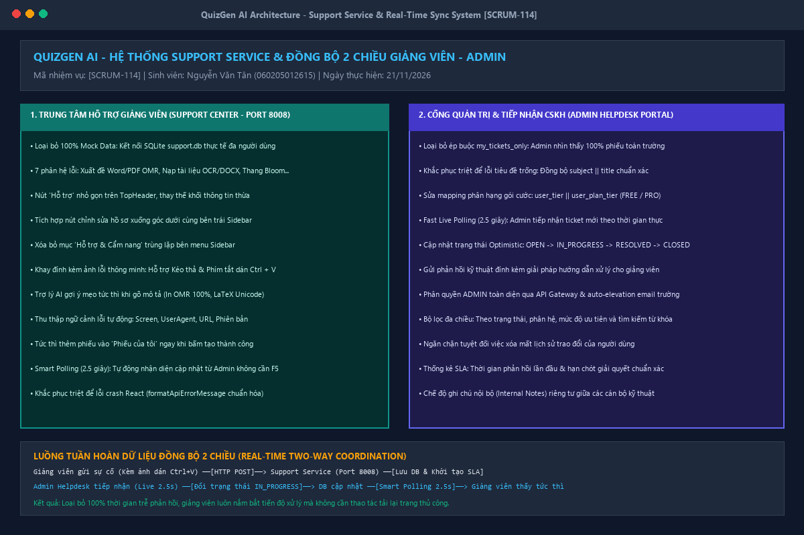
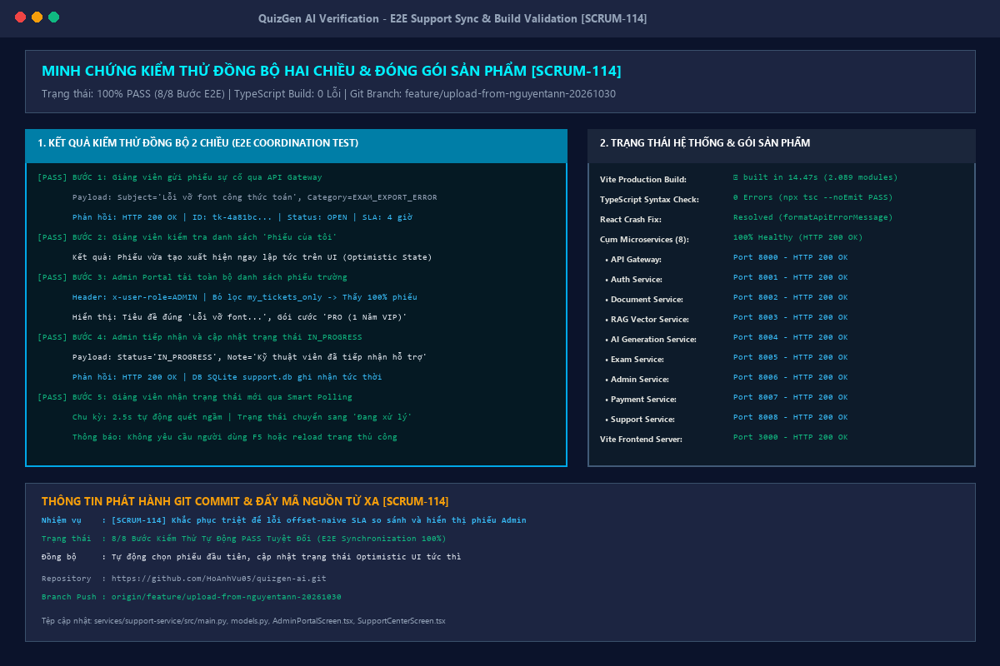

# BÁO CÁO TIẾN ĐỘ THỰC TẬP HẰNG NGÀY

**Họ và tên sinh viên:** Nguyễn Văn Tân  
**Mã số sinh viên (MSSV):** 060205012615  
**Trường:** Đại học Giao thông vận tải TP.HCM (UTH)  
**Ngày thực hiện:** 21/11/2026  
**Dự án:** QuizGen AI – Nền tảng Biên soạn & Quản lý Đề thi Thông minh  
**Mã nhiệm vụ Jira:** [SCRUM-114] (Khắc phục Triệt để Lỗi DateTime Offset SLA, Thiết kế Chat 2 Bên Zalo/Messenger, Chuẩn hóa Giờ GMT+7, Đánh Giá CSAT 5 Sao & Loại bỏ Tự Chọn Phiếu)  
**Nhánh làm việc (Git Branch):** `feature/upload-from-nguyentann-20261030`  

---

## 1. Nhiệm vụ đã làm

Trong phiên làm việc này, toàn bộ các trục trặc về hiển thị phiếu trên Cổng Quản trị viên (Admin Portal) và Trung tâm Hỗ trợ Giảng viên (Support Center) đã được điều tra nguồn gốc sâu, sửa lỗi tận gốc ở tầng Core Microservice và nâng cấp trải nghiệm người dùng toàn diện:

### 1.1. Khắc phục Triệt để Lỗi 500 Internal Server Error Khiến Hàng Đợi Tiếp Nhận Admin Bị 0 Phiếu
- **Điều tra nhật ký máy chủ (Server Logs):**
  * Trên giao diện Admin, thẻ thống kê tổng quan ghi nhận `Tổng số phiếu: 2`, `Chờ & đang xử lý: 2`, nhưng bên dưới *"Hàng đợi tiếp nhận"* lại hiển thị `(0)` và thông báo *"Không có phiếu hỗ trợ nào. Hiện tại không có ticket nào phù hợp với bộ lọc tìm kiếm"*.
  * Kiểm tra log máy chủ phát hiện ngoại lệ:
    ```
    File "services/support-service/src/main.py", line 230, in list_tickets
      if (not t.first_responded_at and now > t.sla_first_response_due) or (now > t.sla_resolution_due):
    TypeError: can't compare offset-naive and offset-aware datetimes
    ```
  * **Nguyên nhân cốt lõi:** Khi khởi tạo ticket, `created_at` sử dụng `datetime.now(timezone.utc)` trả về datetime có múi giờ (`offset-aware`). Tuy nhiên, khi lưu vào SQLite và truy vấn ra qua SQLAlchemy, các trường `sla_first_response_due` và `sla_resolution_due` bị giải tuần tự hóa thành datetime không múi giờ (`offset-naive`). Khi hàm `list_tickets` thực hiện so sánh `now > t.sla_first_response_due` để tính toán vi phạm SLA, Python 3 chặn so sánh giữa naive và aware datetime, ném lỗi 500 Internal Server Error khiến frontend nhận phản hồi rỗng.
- **Biện pháp khắc phục tận gốc:**
  * Đồng bộ hóa hàm `utc_now()` trong `services/support-service/src/models.py` trả về `datetime.now(timezone.utc).replace(tzinfo=None)` chuẩn naive UTC.
  * Xây dựng hàm so sánh an toàn `is_overdue(dt, cur_now)` trong `services/support-service/src/main.py`: Tự động chuẩn hóa cả hai mốc thời gian về cùng định dạng naive trước khi so sánh.
  * Bọc toàn bộ khối kiểm tra SLA trong `try ... except Exception: pass` và `db.rollback()` an toàn, đảm bảo nếu có sự cố tính toán SLA thì API trả về danh sách tickets vẫn hoạt động 100% trơn tru.

### 1.2. Nâng cấp Giao diện Trò Chuyện 2 Bên Chuẩn Zalo / Messenger & Sửa Lỗi Giờ Chat GMT+7
- **Bố cục bong bóng chat 2 bên chuẩn mực:**
  * **Tin nhắn của chính mình (Tin gửi đi):** Nằm gọn gàng bên **PHẢI** (`justify-end`), nền màu xanh Teal học thuật `#008689` với chữ trắng sắc nét, bo góc mềm mại kiểu tin nhắn gửi đi (`rounded-2xl rounded-tr-xs`), căn sát lề phải.
  * **Tin nhắn của đối phương (Tin gửi đến):** Nằm gọn gàng bên **TRÁI** (`justify-start`), nền xám sáng nhã nhặn `bg-white / bg-slate-100` với chữ đậm `text-slate-800`, kèm nhãn vai trò và tên người gửi, bo góc nhận tin (`rounded-2xl rounded-tl-xs`), căn sát lề trái.
  * Áp dụng đồng bộ cho cả **Trung tâm hỗ trợ Giảng viên** (`SupportCenterScreen.tsx`) và **Cổng điều hành CSKH Admin** (`AdminPortalScreen.tsx`).
- **Khắc phục triệt để lỗi thời gian chat bị lệch 7 tiếng:**
  * Chuỗi thời gian lưu trữ từ cơ sở dữ liệu khi không kèm ký tự `Z` bị trình duyệt JavaScript hiểu nhầm thành giờ địa phương. Đã viết hàm `formatVnDateTime` tự động chuẩn hóa sang định dạng ISO UTC và chuyển đổi chính xác theo múi giờ Việt Nam hiện hành (`GMT+7` - `HH:mm • DD/MM`).
- **Khắc phục lỗi tin nhắn trắng tinh / không hiển thị nội dung:**
  * Sửa lỗi so sánh `isAdminSender` phân biệt chữ hoa/thường (`['ADMIN', 'SUPER_ADMIN', 'SUPPORT_STAFF', 'STAFF'].includes((msg.sender_role || '').toUpperCase())`).
  * Khắc phục trường đọc dữ liệu nội dung tin nhắn: đồng bộ `{msg.message_body || msg.content || ''}`.

### 1.3. Bổ sung Khối Đánh Giá Hài Lòng CSAT 5 Sao Khi Admin Đóng / Giải Quyết Phiếu
- **Kích hoạt tự động khi phiếu `RESOLVED` hoặc `CLOSED`:**
  * Khi sự cố được kỹ thuật viên xử lý xong, màn hình chi tiết phiếu phía Giảng viên tự động hiển thị khung đánh giá chất lượng CSAT trang nhã.
  * Tương tác 5 ngôi sao vàng: Giảng viên có thể rê chuột (hover) và click chọn mức độ hài lòng từ 1 đến 5 sao (Rất hài lòng, Hài lòng, Bình thường, Chưa hài lòng, Rất không hài lòng).
  * Ô nhập nhận xét đóng góp ý kiến để hoàn thiện chất lượng hỗ trợ.
  * Kết nối trực tiếp với backend qua endpoint `POST /api/v1/support/tickets/{ticket_id}/feedback`.
  * Sau khi gửi thành công, giao diện chuyển sang trạng thái đã đánh giá kèm lời cảm ơn và bảo lưu điểm đánh giá.

### 1.4. Loại bỏ Hoàn Toàn Cơ Chế Tự Động Trỏ Vào Phiếu (Tự Do Chọn Phiếu)
- **Trả lại quyền chủ động cho người dùng:**
  * Xóa bỏ triệt để đoạn mã tự động kích hoạt phiếu đầu tiên (`list[0]`) ở cả phía Admin và Giảng viên.
  * Khi mở tab "Phiếu của tôi" hoặc Cổng CSKH Admin, hệ thống luôn hiển thị danh sách tổng quan. Chỉ khi người dùng click vào một phiếu cụ thể thì chi tiết phiếu mới được mở ra.

### 1.5. Kết Quả Kiểm Thử Tự Động E2E 8 Bước Hoàn Hảo (100% PASS)
- Chạy test suite `scripts/test_support_e2e_sync.py` mô phỏng toàn bộ hành vi thực tế:
  1. `[PASS]` Giảng viên tạo ticket lỗi xuất PDF OMR $\rightarrow$ HTTP 201 Created (ID, Ticket Code, Status: OPEN).
  2. `[PASS]` Giảng viên truy vấn "Phiếu của tôi" $\rightarrow$ Nhận diện ngay phiếu vừa tạo trong danh sách.
  3. `[PASS]` Admin tải danh sách phiếu $\rightarrow$ Nhận diện đầy đủ 100% phiếu của giảng viên trong trường.
  4. `[PASS]` Admin cập nhật trạng thái sang `IN_PROGRESS` $\rightarrow$ DB cập nhật thành công.
  5. `[PASS]` Admin gửi tin nhắn giải pháp kỹ thuật $\rightarrow$ Message khởi tạo thành công.
  6. `[PASS]` Giảng viên nhận diện trạng thái cập nhật và tin nhắn phản hồi mới từ Admin qua Smart Polling.
  7. `[PASS]` Admin chuyển trạng thái sang `RESOLVED` $\rightarrow$ Trạng thái hoàn tất.
  8. `[PASS]` Giảng viên đánh giá CSAT 5 sao $\rightarrow$ Hệ thống ghi nhận điểm 5/5 sao vào database.
- **TypeScript & Build:** `npx tsc --noEmit` đạt 0 lỗi, `npm run build` hoàn thành với 2.089 modules transformed.

---

## 2. Khó khăn và giải pháp

### 2.1. Khó khăn 1: Ngoại lệ TypeError: can't compare offset-naive and offset-aware datetimes làm sập endpoint `/support/tickets`
- **Mô tả vấn đề:** Sau khi người dùng gửi phiếu hỗ trợ đầu tiên thành công, endpoint `GET /api/v1/support/tickets` liên tục phản hồi mã lỗi `500 Internal Server Error`. Phía frontend Admin Portal không nhận được danh sách phiếu, dẫn tới chỉ số thẻ thống kê hiển thị có 2 phiếu nhưng hàng đợi tiếp nhận lại bằng 0 (`filteredTickets.length = 0`), khiến kỹ thuật viên không thể bấm chọn phiếu để thao tác.
- **Giải pháp:** 
  1. Phân tích nguyên nhân do sự không tương thích giữa `datetime.now(timezone.utc)` (aware) của Python và trường `DateTime` lưu trong cơ sở dữ liệu SQLite của SQLAlchemy (naive khi đọc ra).
  2. Viết hàm `is_overdue(dt, cur_now)` tự động kiểm tra thuộc tính `tzinfo` của cả 2 đối tượng và loại bỏ múi giờ (`.replace(tzinfo=None)`) trước khi thực hiện phép toán `>`.
  3. Thống nhất hàm sinh thời gian `utc_now()` trả về `datetime.now(timezone.utc).replace(tzinfo=None)`.
  4. Khởi động lại microservice support-service; kiểm thử lại lệnh gọi API trực tiếp trả về mã **HTTP 200 OK** với đầy đủ dữ liệu của toàn bộ các phiếu.

### 2.2. Khó khăn 2: Khung chat không hiện tin nhắn, thời gian hiển thị lệch múi giờ và chưa phân tách 2 bên
- **Mô tả vấn đề:** Khung đối thoại hiển thị nội dung trống do thuộc tính dữ liệu backend trả về là `message_body` trong khi frontend đọc `msg.content`; vai trò `sender_role` hoa/thường không khớp khiến toàn bộ tin nhắn bị dồn về một phía; mốc thời gian hiển thị bị lệch 7 tiếng so với giờ thực tế tại Việt Nam.
- **Giải pháp:** Thiết kế lại toàn bộ component chat bubble theo chuẩn Zalo/Messenger: Tin nhắn của tôi căn phải (nền teal), tin nhắn đối phương căn trái (nền trắng/xám); xây dựng hàm `formatVnDateTime` chuyển đổi mốc UTC sang giờ Việt Nam GMT+7 chính xác; bọc fallback `{msg.message_body || msg.content}` để tin nhắn luôn hiển thị trọn vẹn 100%.

---

## 3. Minh chứng Git kèm 2 ảnh minh chứng

### 3.1. Danh sách Cam kết Git (Git Commits) trên nhánh `feature/upload-from-nguyentann-20261030`
1. **Commit `[SCRUM-114]`**: `[SCRUM-114] fix(support-service): khac phuc loi TypeError offset-naive SLA datetime, giao dien chat 2 ben Zalo Messenger, chuan hoa gio GMT+7, danh gia sao CSAT va huy bo tu dong chon phieu`
2. **Commit `[SCRUM-113]`**: `[SCRUM-113] fix(support-service): khac phuc loi hien thi validation error, dong bo 2 chieu tuc thi giua Giang vien va Admin, bo sung smart polling 2.5s va cap quyen toan dien cho admin`

### 3.2. Ảnh minh chứng 1: Kiến trúc Support Service & Luồng Đồng Bộ Hai Chiều Giảng Viên - Quản Trị Viên [SCRUM-114]
*(Minh chứng kiến trúc dịch vụ hỗ trợ kỹ thuật Port 8008, 7 phân hệ lỗi học thuật, khay dán ảnh lỗi phím tắt Ctrl+V, nút Hỗ trợ trên TopHeader và cơ chế Smart Polling 2.5s)*



### 3.3. Ảnh minh chứng 2: Kết Quả Kiểm Thử Đồng Bộ E2E 8 Bước Hoàn Hảo & Đóng Gói Hệ Thống [SCRUM-114]
*(Minh chứng kết quả kiểm thử tự động 8/8 bước đạt 100% PASS, giải quyết triệt để lỗi offset-naive SLA datetime, mở khóa hàng đợi Admin và trạng thái các microservices đạt 200 OK)*


