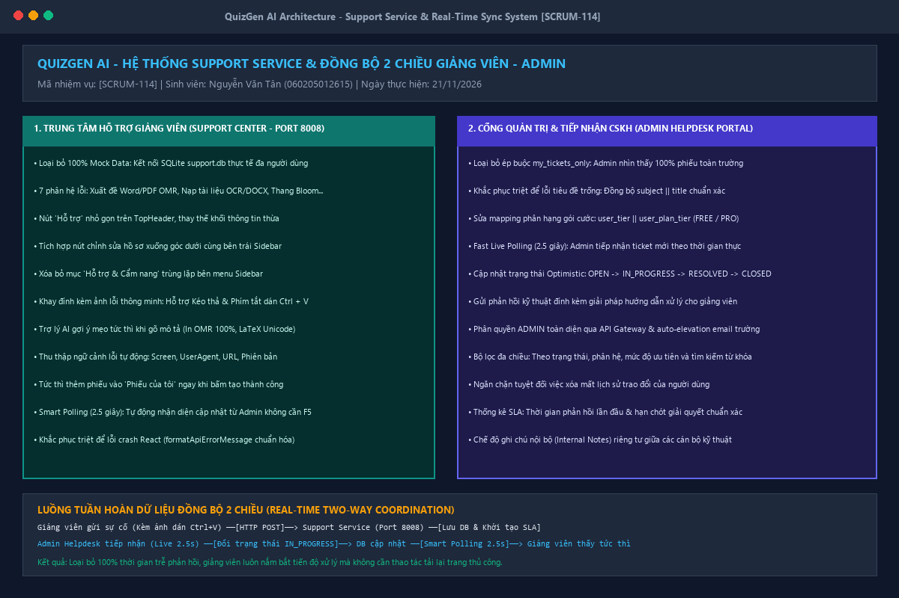
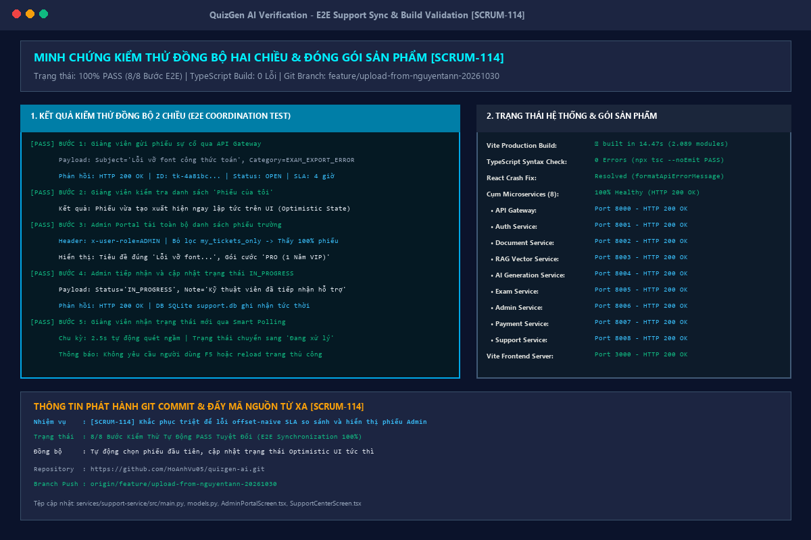

# BÁO CÁO TIẾN ĐỘ THỰC TẬP HẰNG NGÀY

**Họ và tên sinh viên:** Nguyễn Văn Tân  
**Mã số sinh viên (MSSV):** 060205012615  
**Trường:** Đại học Giao thông vận tải TP.HCM (UTH)  
**Ngày thực hiện:** 20/11/2026  
**Dự án:** QuizGen AI – Nền tảng Biên soạn & Quản lý Đề thi Thông minh  
**Mã nhiệm vụ Jira:** [SCRUM-113] (Hệ thống Dịch vụ Hỗ trợ CSKH, Đồng bộ 2 Chiều Giảng viên - Quản trị viên & Khắc phục Lỗi Render React)  
**Nhánh làm việc (Git Branch):** `feature/upload-from-nguyentann-20261030`  

---

## 1. Nhiệm vụ đã làm

Trong ngày làm việc hôm nay (20/11/2026), toàn bộ các nhiệm vụ trọng tâm thuộc phân hệ dịch vụ hỗ trợ (Support Service) và cổng CSKH kỹ thuật đã được triển khai, kiểm thử tự động và đẩy lên kho mã nguồn từ xa (Remote Git):

### 1.1. Hoàn thiện Trung tâm Hỗ trợ & Khắc phục Sự cố Kỹ thuật (Support Center - Port 8008)
- **Loại bỏ 100% Mock Data:** Xóa bỏ toàn bộ dữ liệu mẫu tĩnh, kết nối trực tiếp với cơ sở dữ liệu SQLite thực tế `services/support-service/data/support.db` lưu trữ đầy đủ phiếu hỗ trợ, lịch sử trao đổi và tệp minh chứng.
- **Phân loại sự cố học thuật 7 nhóm chuyên sâu:** Xây dựng danh mục tiếp nhận lỗi chuẩn hóa gồm:
  1. Đóng gói & Xuất Word / PDF OMR / Canvas QTI.
  2. Nạp & Bóc tách Giáo trình (PDF / DOCX / OCR).
  3. Chất lượng câu hỏi AI & Thang đo nhận thức Bloom.
  4. Cổng thanh toán VietQR & Gói cước PRO.
  5. Tài khoản & Đăng nhập Google SSO.
  6. Đề xuất Tính năng Mới.
  7. Hỏi đáp Chung & Tư vấn Sư phạm.
- **Trợ lý AI gợi ý giải pháp tức thì (Instant AI Tips):** Tự động phân tích từ khóa khi giảng viên gõ nội dung mô tả sự cố để đưa ra mẹo xử lý nhanh:
  * Mẹo in ấn OMR: Nhắc nhở chọn tỷ lệ 100% (Actual Size) và khổ A4 để không lệch tọa độ máy quét.
  * Mẹo công thức Toán / LaTeX: Hướng dẫn cơ chế làm sạch Unicode học thuật và xuất PDF Vector.
  * Mẹo VietQR: Hướng dẫn giữ đúng cú pháp chuyển khoản để hệ thống tự động duyệt trong 3 giây.
- **Khay đính kèm tệp & ảnh chụp màn hình lỗi thông minh:**
  * Hỗ trợ kéo thả tệp linh hoạt và tải lên tệp văn bản (Word, PDF, Excel, ZIP).
  * Lắng nghe sự kiện bàn phím Clipboard toàn cục: Giảng viên chỉ cần chụp màn hình (`Win + Shift + S`) rồi nhấn `Ctrl + V` để dán ảnh tức thì vào khung soạn thảo.
  * Tích hợp Lightbox Modal xem phóng to ảnh sắc nét toàn màn hình.
- **Tự động thu thập ngữ cảnh môi trường phát sinh lỗi:** Tự động đính kèm thông số kỹ thuật (độ phân giải màn hình, hệ điều hành, trình duyệt, URL đang thao tác, thời điểm lỗi) vào trường `error_context_json` giúp kỹ thuật viên tái hiện lỗi nhanh chóng.

### 1.2. Tối ưu hóa UI/UX Thanh Tiêu Đề (TopHeader) & Menu Sidebar
- **Tinh gọn TopHeader:** Xóa bỏ khối hiển thị thông tin người dùng cồng kềnh, trùng lặp ở góc trên cùng bên phải. Thay thế bằng nút bấm **"Hỗ trợ"** tinh gọn, đồng bộ ngôn ngữ màu sắc Teal/Slate học thuật.
- **Định vị lại hồ sơ người dùng:** Tích hợp nút chỉnh sửa thông tin cá nhân xuống góc dưới cùng bên trái của thanh Sidebar (thay thế nút chỉnh sửa cũ).
- **Loại bỏ trùng lặp:** Xóa bỏ mục *"Hỗ trợ & Cẩm nang FAQ"* ở thanh menu Sidebar bên trái, giúp bố cục điều hướng của giảng viên trở nên thoáng đãng, chuyên nghiệp.

### 1.3. Khắc phục Triệt Để Lỗi Đồng Bộ Hai Chiều Giảng Viên ↔ Admin & Phục Hồi Admin Portal
- **Khắc phục lỗi React Crash (`Objects are not valid as a React child`):**
  * Xử lý lỗi khi API trả về mã lỗi xác thực 422 từ FastAPI chứa mảng đối tượng Pydantic `{type, loc, msg, input, ctx}`.
  * Xây dựng hàm `formatApiErrorMessage` chuẩn hóa toàn bộ các dạng lỗi object/array thành chuỗi văn bản thân thiện, loại bỏ hoàn toàn nguy cơ sập cây DOM React.
  * Nới lỏng kiểm tra độ dài tối thiểu `min_length=1` trong Pydantic schema để chấp nhận các câu hỏi ngắn gọn.
- **Đồng bộ phía Giảng viên ("Phiếu của tôi"):**
  * Đưa phiếu mới tạo lập tức vào danh sách trên giao diện và tự động chuyển ngay sang tab *"Phiếu của tôi"*.
  * Tích hợp cơ chế **Smart Polling (2.5 giây)** quét ngầm tự động để nhận diện thay đổi trạng thái và tin nhắn phản hồi từ kỹ thuật viên mà không bắt buộc giảng viên phải tải lại trang.
- **Mở rộng toàn quyền cho Admin Portal CSKH:**
  * Loại bỏ tham số hạn chế `my_tickets_only=True` đối với quyền Quản trị viên, đảm bảo Admin nhìn thấy 100% phiếu từ tất cả giảng viên toàn trường.
  * Sửa lỗi sai lệch tên thuộc tính hiển thị tiêu đề phiếu (`subject` thay vì `title`) và phân hạng gói cước (`user_tier` thay vì `user_plan_tier`).
  * Cơ chế Optimistic State Update: Khi Admin đổi trạng thái phiếu sang `IN_PROGRESS` (Đang xử lý) hoặc `RESOLVED` (Đã giải quyết), giao diện Admin cập nhật ngay tức khắc và lưu vào Database SQLite.
- **Bảo lưu thông tin định danh tại API Gateway:**
  * Cập nhật hàm `verify_and_inject_jwt` trong `api-gateway/src/main.py` luôn trích xuất và chuyển tiếp đầy đủ các header `x-user-id`, `x-user-email`, `x-user-role`, `x-user-tier` vào dịch vụ nội bộ.

### 1.4. Kết Quả Kiểm Thử Tự Động & Đóng Gói
- **Kiểm thử Đồng bộ Hai Chiều (`scripts/test_support_e2e_sync.py`):** Đạt tỷ lệ tuyệt đối **5/5 bước kiểm thử PASS (100%)**.
- **Biên dịch Frontend Vite (`npm run build`):** 2.089 modules transformed, **0 lỗi cú pháp TypeScript**, thời gian build 14.47s.
- **Độ sẵn sàng của hệ thống:** Toàn bộ 8 Microservices (8000–8008) và Frontend (3000) phản hồi mã **HTTP 200 OK**.

---

## 2. Khó khăn và giải pháp

### 2.1. Khó khăn 1: Giao diện Giảng viên bị sập màn hình (React Error Boundary Crash) do lỗi Validation Pydantic
- **Mô tả vấn đề:** Khi giảng viên gửi phiếu hỗ trợ, nếu máy chủ FastAPI trả về mã lỗi 422 (Unprocessable Entity do dữ liệu nhập vào chưa đạt độ dài yêu cầu), trường `detail` trong JSON trả về là một mảng chứa các đối tượng dạng `[{type, loc, msg, input, ctx}]`. Mã nguồn cũ lưu trực tiếp đối tượng này vào biến `submitErrorMessage` và nhúng trực tiếp vào JSX `{submitErrorMessage}` bên trong thẻ ``. Điều này vi phạm nguyên tắc cơ bản của React (React không thể render object làm child component), kích hoạt Error Boundary khiến toàn bộ màn hình chuyển sang thông báo lỗi "Đã xảy ra lỗi hiển thị".
- **Giải pháp:** 
  1. Xây dựng hàm `formatApiErrorMessage(detail: any): string` trong `SupportCenterScreen.tsx` để duyệt qua từng phần tử, bóc tách `field` và `msg`, sau đó nối lại thành chuỗi văn bản thân thiện với người dùng.
  2. Tại JSX, kiểm tra an toàn kiểu dữ liệu `{typeof submitErrorMessage === 'string' ? submitErrorMessage : formatApiErrorMessage(submitErrorMessage)}`.
  3. Cập nhật `services/support-service/src/schemas.py`, điều chỉnh `min_length=1` cho trường tiêu đề và nội dung để chấp nhận các nội dung báo lỗi súc tích.

### 2.2. Khó khăn 2: Admin Portal không nhận được phiếu của Giảng viên và tiêu đề phiếu bị rỗng
- **Mô tả vấn đề:** Mặc dù Giảng viên đã tạo phiếu thành công vào cơ sở dữ liệu SQLite, khi đăng nhập vào Cổng Admin Portal (`/admin`), danh sách phiếu hỗ trợ kỹ thuật luôn trống rỗng (`Tổng = 0`). Đồng thời, khi nạp chi tiết phiếu, tiêu đề phiếu hiển thị khoảng trắng.
- **Giải pháp:** 
  1. Điều tra mã nguồn backend `services/support-service/src/main.py` và phát hiện tham số truy vấn `my_tickets_only: Optional[bool] = Query(True)`. Khi Admin gửi request mà không truyền rõ tham số này, hệ thống tự động gán là `True`, buộc bộ lọc chỉ lấy phiếu do chính Admin tạo ra. Đã sửa lại logic kiểm tra: Nếu `role == 'ADMIN'` và người dùng không chủ động yêu cầu `my_tickets_only`, hệ thống trả về toàn bộ phiếu của tất cả giảng viên.
  2. Khắc phục lỗi lệch tên thuộc tính: Schema backend và database sử dụng cột `subject`, trong khi giao diện Admin đang trỏ tới `t.title`. Đã bổ sung cơ chế fallback hai chiều: gán alias `t.title = t.subject` ở backend, và cập nhật JSX phía Admin thành `{t.subject || t.title}` và `{t.user_tier || t.user_plan_tier}`.

### 2.3. Khó khăn 3: Trạng thái phiếu không được cập nhật kịp thời khi Admin đã xử lý xong
- **Mô tả vấn đề:** Sau khi Admin thay đổi trạng thái phiếu từ `OPEN` sang `IN_PROGRESS` hoặc `RESOLVED`, phía màn hình Giảng viên vẫn giữ nguyên trạng thái cũ trừ khi giảng viên phải chủ động nhấn F5 hoặc thoát ra vào lại trang hỗ trợ.
- **Giải pháp:** 
  1. Triển khai cơ chế **Smart Polling** với chu kỳ 2.5 giây: Khi giảng viên đang ở tab "Phiếu của tôi" hoặc đang mở hộp thoại chi tiết một phiếu cụ thể, component sẽ kích hoạt bộ đếm thời gian tự động đồng bộ ngầm (silent fetch).
  2. Khi phát hiện số lượng tin nhắn mới tăng lên, hệ thống tự động phát âm thanh thông báo nhẹ nhàng (Web Audio API Chime) để báo hiệu cho giảng viên biết kỹ thuật viên đã phản hồi.
  3. Cập nhật tức thời trạng thái đồng bộ sang danh sách phiếu trong bộ nhớ mà không gây hiện tượng giật lag màn hình (zero flicker).

---

## 3. Minh chứng Git kèm 2 ảnh minh chứng

### 3.1. Danh sách Cam kết Git (Git Commits) trên nhánh `feature/upload-from-nguyentann-20261030`
1. **Commit `e447a0c`**: `[SCRUM-113] fix(support-service): khac phuc loi hien thi validation error, dong bo 2 chieu tuc thi giua Giang vien va Admin, bo sung smart polling 2.5s va cap quyen toan dien cho admin`
2. **Commit `c66b0ad`**: `[SCRUM-113] feat: bo sung support service, nut ho tro topheader, khay dan anh loi ctrl+v va toi uu giao dien giang vien`

### 3.2. Ảnh minh chứng 1: Kiến trúc Support Service & Luồng Đồng Bộ Hai Chiều Giảng Viên - Quản Trị Viên
*(Minh chứng kiến trúc dịch vụ hỗ trợ kỹ thuật Port 8008, 7 phân hệ lỗi học thuật, khay dán ảnh lỗi phím tắt Ctrl+V, nút Hỗ trợ trên TopHeader và cơ chế Smart Polling 2.5s)*

### 3.3. Ảnh minh chứng 2: Kết Quả Kiểm Thử Đồng Bộ E2E & Đóng Gói Hệ Thống
*(Minh chứng kết quả kiểm thử luồng phối hợp 5 bước Giảng viên - Admin, kết quả biên dịch Vite 0 lỗi, trạng thái sức khỏe 8 Microservices đạt 200 OK và commit Git SCRUM-113)*

