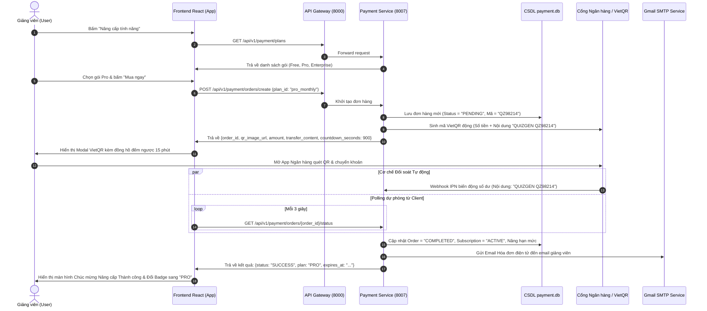

# ĐẶC TẢ KIẾN TRÚC & CHỨC NĂNG DỊCH VỤ THANH TOÁN & QUẢN LÝ GÓI CƯỚC (PAYMENT & SUBSCRIPTION SERVICE)

**Dịch vụ:** `payment-service` (Dự kiến Cổng 8007 / Microservice Thanh toán QR, Nâng cấp Gói Cước & Phân bổ Hạn mức)  
**Hệ thống:** QuizGen AI – Nền tảng Khảo thí & Khởi tạo Đề thi Học thuật  
**Tác giả đặc tả:** Nguyễn Văn Tân (060205012615)  
**Phiên bản:** v1.0.0 Architecture & Functional Specification  
**Ngày phát hành:** 14/11/2026  

---

## MỤC LỤC TỔNG QUAN

1. [Mục tiêu & Tầm nhìn Nghiệp vụ](#1-mục-tiêu--tầm-nhìn-nghiệp-vụ)
2. [Kiến trúc Tổng thể Hệ thống & Luồng Dữ liệu (Architecture & Data Flow)](#2-kiến-trúc-tổng-thể-hệ-thống--luồng-dữ-liệu-architecture--data-flow)
3. [Mô hình Gói Cước & Ma trận Hạn mức (Subscription Plans & Quota Matrix)](#3-mô-hình-gói-cước--ma-trận-hạn-mức-subscription-plans--quota-matrix)
4. [Động cơ Thanh toán QR Code & Tự động Đối soát (QR Engine & Auto Reconciliation)](#4-động-cơ-thanh-toán-qr-code--tự-động-đối-soát-qr-engine--auto-reconciliation)
5. [Quy trình Kích hoạt Gói & Tự động Gửi Email Hóa đơn (Post-payment & Invoicing)](#5-quy-trình-kích-hoạt-gói--tự-động-gửi-email-hóa-đơn-post-payment--invoicing)
6. [Đặc tả Cơ sở Dữ liệu (Database Schema)](#6-đặc-tả-cơ-sở-dữ-liệu-database-schema)
7. [Đặc tả Chi tiết API RESTful Endpoints](#7-đặc-tả-chi-tiết-api-restful-endpoints)
8. [Đặc tả Giao diện Người dùng & Trải nghiệm UI/UX (Frontend Components)](#8-đặc-tả-giao-diện-người-dùng--trải-nghiệm-uiux-frontend-components)
9. [Cơ chế Kiểm soát Hạn mức Thời gian Thực (Real-time Quota Enforcement)](#9-cơ-chế-kiểm-soát-hạn-mức-thời-gian-thực-real-time-quota-enforcement)
10. [Kế hoạch & Lộ trình Triển khai Kỹ thuật (Implementation Roadmap)](#10-kế-hoạch--lộ-trình-triển-khai-kỹ-thuật-implementation-roadmap)

---

## 1. MỤC TIÊU & TẦM NHÌN NGHIỆP VỤ

Nhằm phát triển QuizGen AI theo mô hình **SaaS Freemium** bền vững, dịch vụ `payment-service` được thiết kế nhằm đáp ứng các bài toán cốt lõi:
- **Cấp phát hạn mức Free mặc định:** Mỗi tài khoản khi đăng ký/đăng nhập lần đầu tự động được cấp gói **Free Tier** với hạn mức sử dụng vừa đủ để trải nghiệm các tính năng cốt lõi (upload tài liệu, sinh câu hỏi AI, biên tập đề thi).
- **Minh bạch thông tin tài khoản:** Trên thanh điều hướng và thông tin tài khoản luôn hiển thị trực quan nhãn gói cước (`FREE`, `PRO`, `ENTERPRISE`) kèm thanh tiến trình đo lường tài nguyên đã sử dụng.
- **Quy trình Nâng cấp 1-Chạm qua QR Code:** Khi người dùng có nhu cầu mở rộng hạn mức, chỉ cần bấm **"Nâng cấp tính năng"**, chọn gói phù hợp và quét mã VietQR tự động sinh từ ngân hàng/cổng thanh toán.
- **Tự động hóa 100% (Zero Manual Work):** Hệ thống tự động lắng nghe biến động số dư qua Webhook, kích hoạt nâng hạn mức ngay lập tức trong vòng 3–5 giây, đồng thời gửi email thông báo kèm hóa đơn điện tử về hòm thư của giảng viên.

---

## 2. KIẾN TRÚC TỔNG THỂ HỆ THỐNG & LUỒNG DỮ LIỆU (ARCHITECTURE & DATA FLOW)

### 2.1. Vị trí trong Hệ sinh thái Microservices
`payment-service` hoạt động trên **Cổng 8007**, kết nối chặt chẽ với các dịch vụ hiện hữu thông qua API Gateway (8000):

```
                               ┌────────────────────────────────────────┐
                               │             React Frontend             │
                               │  (Header Badge, Pricing Modal, VietQR) │
                               └───────────────────┬────────────────────┘
                                                   │
                                                   ▼
                               ┌────────────────────────────────────────┐
                               │       API Gateway (Port 8000)          │
                               │        Proxy: /api/v1/payment/*        │
                               └───────┬────────────────────────┬───────┘
                                       │                        │
               ┌───────────────────────┘                        └───────────────────────┐
               ▼                                                                        ▼
┌──────────────────────────────┐                                        ┌──────────────────────────────┐
│   Auth Service (Port 8001)   │                                        │  Payment Service (Port 8007) │
│ • Xác thực JWT               │                                        │ • Quản lý gói cước & Orders  │
│ • Cấp hạn mức Free ban đầu   │                                        │ • Sinh mã VietQR động        │
└──────────────┬───────────────┘                                        │ • Xử lý Webhook ngân hàng    │
               │                                                        │ • Gửi Email hóa đơn tự động  │
               │                                                        └──────────────┬───────────────┘
               │                                                                       │
               ▼                                                                       ▼
┌──────────────────────────────┐                                        ┌──────────────────────────────┐
│       CSDL auth.db           │                                        │       CSDL payment.db        │
│ • users (plan_tier, quota_id)│                                        │ • plans, subscriptions       │
└──────────────────────────────┘                                        │ • orders, transactions       │
                                                                        └──────────────────────────────┘
```

### 2.2. Sơ đồ Tuần tự Luồng Nâng cấp & Thanh toán QR (Sequence Diagram)



---

## 3. MÔ HÌNH GÓI CƯỚC & MA TRẬN HẠN MỨC (SUBSCRIPTION PLANS & QUOTA MATRIX)

Hệ thống cung cấp 3 tầng gói dịch vụ (Tier Levels) với hạn mức phân cấp rõ ràng:

| Tiêu chí / Hạn mức | Gói Trải Nghiệm (FREE) | Gói Chuyên Nghiệp (PRO) | Gói Khoa - Bộ Môn (ENTERPRISE) |
| :--- | :---: | :---: | :---: |
| **Giá niêm yết** | **0 VNĐ** (Mặc định) | **199.000 VNĐ / tháng** | **990.000 VNĐ / năm** |
| **Huy hiệu hiển thị** | `Gói Miễn Phí` (Xám/Xanh nhạt) | `Gói PRO Giảng Viên` (Vàng Kim/Cam) | `Gói Bộ Môn Toàn Năng` (Tím Hoàng Gia) |
| **Số giáo trình lưu trữ** | Tối đa **3 tài liệu** | **Không giới hạn** | **Không giới hạn** |
| **Dung lượng mỗi tệp** | Tối đa **10 MB** / file | Tối đa **50 MB** / file | Tối đa **100 MB** / file |
| **Số câu hỏi sinh bằng AI**| **50 câu** / tháng | **1.000 câu** / tháng | **Không giới hạn** |
| **Hỗ trợ ma trận Bloom** | Cấp 1 (Nhận biết) + Cấp 2 (Thông hiểu) | Trọn bộ 4 cấp độ (Nhận biết $\rightarrow$ Phân tích) | Trọn bộ + Tùy biến thang đo riêng |
| **Xuất đề Word/PDF** | 2 lượt xuất / tháng | Không giới hạn | Không giới hạn |
| **Xuất gói LMS QTI/Moodle** | ❌ Không hỗ trợ | ✅ Hỗ trợ đầy đủ | ✅ Hỗ trợ đầy đủ |
| **Đảo đa mã đề (Variant)**| Tối đa 2 mã đề hoán vị | Lên đến 8 mã đề cùng lúc | Không giới hạn mã đề |
| **Hỗ trợ kỹ thuật** | Cộng đồng | Ưu tiên trong 2 giờ | Hotline riêng 24/7 |

---

## 4. ĐỘNG CƠ THANH TOÁN QR CODE & TỰ ĐỘNG ĐỐI SOÁT (QR ENGINE & AUTO RECONCILIATION)

### 4.1. Chuẩn hóa Mã VietQR (NAPAS 247)
Mã QR thanh toán được sinh theo tiêu chuẩn quốc gia **VietQR (EMVCo Compatible)**:
- **Ngân hàng thụ hưởng:** MB Bank / Techcombank / Vietcombank (tài khoản đối tác hệ thống).
- **Cú pháp định danh chuyển khoản (Transaction Tag):**  
  `QUIZGEN <MÃ_ĐƠN_HÀNG>`  
  *(Ví dụ: `QUIZGEN P84291` — độ dài ngắn gọn, chống nhầm lẫn khi người dùng nhập tay).*
- **Đường dẫn sinh ảnh QR động:**  
  `https://img.vietqr.io/image/<BANK_ID>-<ACCOUNT_NO>-compact2.png?amount=<AMOUNT>&addInfo=<TRANSFER_CONTENT>&accountName=<ACCOUNT_NAME>`

### 4.2. Cơ chế Đối soát Kép (Dual Verification Strategy)
Để đảm bảo người dùng được kích hoạt dịch vụ ngay lập tức mà không bao giờ bị nghẽn:
1. **Webhook / Server-to-Server Callback (Ưu tiên số 1):** Tích hợp với dịch vụ Payment Hub (SePay / PayOS / Casso). Ngay khi ngân hàng ghi nhận tiền vào tài khoản, webhook gửi payload JSON đến `POST /api/v1/payment/webhook`. Hệ thống kiểm tra chữ ký HMAC-SHA256, kiểm tra số tiền và khớp mã đơn hàng để duyệt tự động trong **< 2 giây**.
2. **Client Smart Polling (Dự phòng số 2):** Khi Modal QR hiển thị, Frontend tự động kích hoạt polling định kỳ mỗi 3 giây đến endpoint `GET /api/v1/payment/orders/{order_id}/status`. Khi đơn hàng chuyển trạng thái sang `COMPLETED`, giao diện lập tức kích hoạt hiệu ứng thành công.
3. **Đồng hồ đếm ngược an toàn:** Thời hạn hiệu lực của đơn hàng và mã QR là **15 phút (900 giây)**. Hết thời gian, đơn hàng tự động chuyển sang `EXPIRED` để tránh giao dịch treo.

---

## 5. QUY TRÌNH KÍCH HOẠT GÓI & TỰ ĐỘNG GỬI EMAIL HÓA ĐƠN (POST-PAYMENT & INVOICING)

### 5.1. Kích hoạt dịch vụ & Nâng hạn mức Quotas
Ngay khi giao dịch được xác thực thành công:
1. Cập nhật bảng `subscriptions`: Đặt trạng thái `active`, hạn dùng được cộng dồn (30 ngày cho gói tháng, 365 ngày cho gói năm).
2. Đồng bộ sang bảng `auth.users`: Cập nhật `plan_tier = 'pro'`, mở khóa toàn bộ tính năng nâng cao.
3. Cập nhật `usage_quotas`: Nâng trần tài nguyên (ví dụ: `max_questions_per_month = 1000`, `allow_qti_export = true`).

### 5.2. Mẫu Email Hóa đơn & Xác nhận Tự động
Hệ thống sử dụng cổng Gmail SMTP của hệ thống (`quizgen.ai.team@gmail.com`) gửi email định dạng HTML chuyên nghiệp:
- **Tiêu đề email:** `[QuizGen AI] Xác nhận thanh toán thành công & Kích hoạt Gói cước #{ORDER_ID}`
- **Nội dung email bao gồm:**
  - Lời chúc mừng và cảm ơn giảng viên.
  - Bảng thông tin hóa đơn: Mã đơn hàng, Tên gói cước, Số tiền thanh toán, Thời điểm thanh toán, Ngày hết hạn gói.
  - Danh sách quyền lợi và hạn mức mới được kích hoạt.
  - Hướng dẫn truy cập và đường dẫn hỗ trợ kỹ thuật ưu tiên.

---

## 6. ĐẶC TẢ CƠ SỞ DỮ LIỆU (DATABASE SCHEMA)

Cơ sở dữ liệu lưu trữ tại tệp `payment.db` (SQLite cục bộ) hoặc schema `payment` trên PostgreSQL, đảm bảo độc lập hoàn toàn với `auth.db` và `documents.db`:

```sql
-- 1. Bảng danh mục gói cước
CREATE TABLE IF NOT EXISTS plans (
    id VARCHAR(50) PRIMARY KEY,              -- 'plan_free', 'plan_pro_monthly', 'plan_pro_yearly', 'plan_enterprise'
    name VARCHAR(100) NOT NULL,             -- 'Gói Trải Nghiệm', 'Gói PRO Giảng Viên (Tháng)', ...
    code VARCHAR(20) UNIQUE NOT NULL,       -- 'FREE', 'PRO_MONTH', 'PRO_YEAR', 'ENTERPRISE'
    price_vnd INTEGER NOT NULL DEFAULT 0,   -- 0, 199000, 1990000, ...
    duration_days INTEGER NOT NULL,         -- 0 (vĩnh viễn), 30, 365
    max_documents INTEGER NOT NULL,         -- 3, 999999
    max_questions_month INTEGER NOT NULL,   -- 50, 1000, 999999
    max_exams_month INTEGER NOT NULL,       -- 2, 999999
    allow_qti_export BOOLEAN DEFAULT FALSE, -- Cho phép xuất Canvas/Moodle
    allow_full_bloom BOOLEAN DEFAULT FALSE, -- Cho phép đủ 4 cấp Bloom
    features_json TEXT,                     -- Danh sách mô tả tính năng JSON
    is_active BOOLEAN DEFAULT TRUE,
    created_at TIMESTAMP DEFAULT CURRENT_TIMESTAMP
);

-- 2. Bảng gói đăng ký của người dùng
CREATE TABLE IF NOT EXISTS subscriptions (
    id VARCHAR(50) PRIMARY KEY,              -- 'sub_xxxx'
    user_id VARCHAR(50) NOT NULL,           -- Khóa ngoại logic tới auth.users(id)
    plan_id VARCHAR(50) NOT NULL REFERENCES plans(id),
    status VARCHAR(20) NOT NULL,            -- 'active', 'expired', 'cancelled'
    starts_at TIMESTAMP NOT NULL,
    expires_at TIMESTAMP,                  -- NULL nếu là gói FREE vĩnh viễn
    auto_renew BOOLEAN DEFAULT FALSE,
    created_at TIMESTAMP DEFAULT CURRENT_TIMESTAMP,
    updated_at TIMESTAMP DEFAULT CURRENT_TIMESTAMP
);

-- 3. Bảng đơn hàng giao dịch
CREATE TABLE IF NOT EXISTS orders (
    id VARCHAR(50) PRIMARY KEY,              -- 'ORD_20261114_001'
    order_code VARCHAR(20) UNIQUE NOT NULL, -- 'QZ98214'
    user_id VARCHAR(50) NOT NULL,
    plan_id VARCHAR(50) NOT NULL REFERENCES plans(id),
    amount_vnd INTEGER NOT NULL,
    payment_method VARCHAR(20) NOT NULL,    -- 'VIETQR', 'MOMO', 'BANK_TRANSFER'
    status VARCHAR(20) NOT NULL,            -- 'PENDING', 'COMPLETED', 'FAILED', 'EXPIRED'
    qr_url TEXT,                            -- Link ảnh mã VietQR
    transfer_content VARCHAR(50) NOT NULL,  -- 'QUIZGEN QZ98214'
    paid_at TIMESTAMP,                      -- Thời điểm nhận tiền thực tế
    bank_reference VARCHAR(100),            -- Mã giao dịch ngân hàng (FTxxxx)
    created_at TIMESTAMP DEFAULT CURRENT_TIMESTAMP,
    expires_at TIMESTAMP NOT NULL           -- created_at + 15 phút
);

-- 4. Bảng nhật ký sử dụng hạn mức (Quota Usage Tracking)
CREATE TABLE IF NOT EXISTS user_quotas (
    user_id VARCHAR(50) PRIMARY KEY,
    documents_count INTEGER DEFAULT 0,
    questions_generated_this_month INTEGER DEFAULT 0,
    exams_exported_this_month INTEGER DEFAULT 0,
    quota_reset_date DATE NOT NULL,         -- Ngày reset quota định kỳ hằng tháng
    updated_at TIMESTAMP DEFAULT CURRENT_TIMESTAMP
);
```

---

## 7. ĐẶC TẢ CHI TIẾT API RESTFUL ENDPOINTS

Tất cả các API được bảo vệ qua JWT Bearer Token (trừ Webhook ngân hàng sử dụng chữ ký bí mật API Key / HMAC):

### 7.1. Nhóm API Gói cước & Hạn mức
- **`GET /api/v1/payment/plans`**
  - **Mô tả:** Lấy danh sách toàn bộ các gói cước đang mở bán, giá cả và danh mục quyền lợi.
  - **Phản hồi:** Danh sách các object `Plan` có gắn kèm nhãn nổi bật (`is_popular: true`).
- **`GET /api/v1/payment/subscription/my`**
  - **Mô tả:** Lấy thông tin gói cước hiện tại của người dùng đăng nhập, ngày hết hạn và số liệu hạn mức đã tiêu thụ trong tháng.
  - **Phản hồi mẫu:**
    ```json
    {
      "plan_code": "FREE",
      "plan_name": "Gói Trải Nghiệm Miễn Phí",
      "status": "active",
      "expires_at": null,
      "quotas": {
        "documents": { "used": 2, "max": 3, "percent": 66.7 },
        "questions_this_month": { "used": 35, "max": 50, "percent": 70.0 },
        "exams_this_month": { "used": 1, "max": 2, "percent": 50.0 },
        "allow_qti": false,
        "allow_full_bloom": false
      }
    }
    ```

### 7.2. Nhóm API Khởi tạo & Thanh toán Đơn hàng
- **`POST /api/v1/payment/orders/create`**
  - **Mô tả:** Tạo đơn hàng nâng cấp mới và trả về dữ liệu ảnh mã QR thanh toán tức thì.
  - **Payload:** `{ "plan_id": "plan_pro_monthly", "payment_method": "VIETQR" }`
  - **Phản hồi:**
    ```json
    {
      "order_id": "ord_91823192",
      "order_code": "QZ98214",
      "amount": 199000,
      "bank_info": {
        "bank_name": "MB Bank (Ngân hàng Quân đội)",
        "account_number": "0987654321",
        "account_name": "CONG TY QUIZGEN AI"
      },
      "transfer_content": "QUIZGEN QZ98214",
      "qr_url": "https://img.vietqr.io/image/MB-0987654321-compact2.png?amount=199000&addInfo=QUIZGEN%20QZ98214&accountName=CONG%20TY%20QUIZGEN%20AI",
      "countdown_seconds": 900
    }
    ```
- **`GET /api/v1/payment/orders/{order_id}/status`**
  - **Mô tả:** Dành cho Frontend polling kiểm tra trạng thái đơn hàng (`PENDING`, `COMPLETED`, `EXPIRED`).

### 7.3. Nhóm API Webhook & Quản trị
- **`POST /api/v1/payment/webhook`**
  - **Mô tả:** Nhận callback thông báo biến động số dư từ SePay / PayOS / Ngân hàng.
  - **Bảo mật:** Kiểm tra Header `X-Webhook-Secret` hoặc chữ ký `HMAC-SHA256`.
- **`POST /api/v1/payment/orders/{order_id}/mock-confirm`** *(Chỉ bật trên môi trường Dev/Staging)*
  - **Mô tả:** Cho phép lập trình viên hoặc tester giả lập thanh toán thành công để kiểm thử luồng nâng cấp tức thì.

---

## 8. ĐẶC TẢ GIAO DIỆN NGƯỜI DÙNG & TRẢI NGHIỆM UI/UX (FRONTEND COMPONENTS)

### 8.1. Huy hiệu Gói cước trên TopHeader (`TopHeader.tsx`)
- Nằm cạnh avatar và thông tin cá nhân của giảng viên:
  - Nếu là tài khoản Free: Hiển thị badge xám `[Gói Miễn Phí]` kèm nút bấm nhỏ `[⭐ Nâng cấp]`.
  - Nếu là tài khoản Pro: Hiển thị badge vàng viền kim loại `[👑 Gói PRO Giảng Viên]` kèm tooltip hiển thị hạn dùng (VD: `Hạn dùng: 14/12/2026`).

### 8.2. Modal Bảng Giá & So sánh Gói Cước (`PricingPlansModal.tsx`)
- Thiết kế hiện đại dạng 3 cột thẻ nổi bật:
  - Cột 1: **Gói Trải Nghiệm** (Đang sử dụng).
  - Cột 2: **Gói PRO Giảng Viên** (Có dải ruy-băng `Được tin dùng nhất`, nút bấm màu gradient ngọc lục bảo `Nâng Cấp Ngay - 199.000đ/tháng`).
  - Cột 3: **Gói Khoa - Bộ Môn** (Nút bấm `Liên hệ hợp tác`).
- Bảng so sánh chi tiết tính năng tích xanh/đỏ trực quan.

### 8.3. Modal Quét Mã VietQR Thanh Toán (`PaymentQRModal.tsx`)
- **Phía trên:** Tiêu đề *"Thanh toán Đơn hàng nâng cấp Gói PRO"* kèm mã đơn hàng.
- **Trung tâm:**
  - Ảnh mã VietQR sắc nét, có nút *"Tải ảnh QR về máy"*.
  - Khung thông tin chuyển khoản: Số tiền (nổi bật màu đỏ đậm), Số tài khoản, Ngân hàng, Nội dung chuyển khoản kèm **Nút Copy 1-chạm** tiện lợi.
- **Phía dưới:**
  - Thanh đếm ngược thời gian còn lại: `Thời gian giữ đơn: 14:59`.
  - Hiệu ứng sóng radar xoay nhẹ kèm dòng chữ: *"Hệ thống đang tự động nhận diện giao dịch chuyển khoản..."*.
  - Nút kiểm tra thủ công: *"Tôi đã chuyển khoản thành công"*.

### 8.4. Màn hình Chúc Mừng & Bật Tính Năng (`PaymentSuccessModal.tsx`)
- Hiệu ứng pháo hoa chúc mừng (Confetti animation).
- Biểu tượng tích xanh bảo chứng giao dịch thành công.
- Thông báo: *"Chúc mừng Thầy/Cô đã nâng cấp thành công Gói PRO Giảng Viên! Hạn mức mới đã được kích hoạt và hóa đơn đã được gửi tới email của Thầy/Cô."*
- Nút bấm: *"Bắt đầu sử dụng ngay"*.

---

## 9. CƠ CHẾ KIỂM SOÁT HẠN MỨC THỜI GIAN THỰC (REAL-TIME QUOTA ENFORCEMENT)

Nhằm bảo đảm hạn mức cước phí được thực thi nghiêm túc:
1. **Tại `document-service`:** Khi giảng viên tải lên tệp giáo trình thứ 4 (nếu đang ở gói Free), API trả về mã lỗi `HTTP 402 Payment Required` với mã lỗi `LIMIT_DOCUMENTS_EXCEEDED` $\rightarrow$ Frontend tự động bật Popup nhắc nâng cấp gói cước.
2. **Tại `ai-service`:** Trước khi gọi mô hình Google Gemini sinh câu hỏi, dịch vụ kiểm tra tổng số câu hỏi đã sinh trong tháng. Nếu vượt quá 50 câu (gói Free), từ chối sinh và đề xuất nâng cấp.
3. **Tại `exam-service`:** Chặn tính năng xuất đề thi định dạng QTI 2.1 (Canvas/Moodle) nếu tài khoản không sở hữu gói Pro trở lên.

---

## 10. KẾ HOẠCH & LỘ TRÌNH TRIỂN KHAI KỸ THUẬT (IMPLEMENTATION ROADMAP)

- **Giai đoạn 1 (Backend Core & Database):**
  - Tạo cấu trúc thư mục `services/payment-service/`.
  - Khởi tạo cơ sở dữ liệu `payment.db`, seed dữ liệu 3 gói cước mẫu.
  - Hoàn thiện các API CRUD gói cước, tạo đơn hàng và sinh chuỗi URL VietQR.
- **Giai đoạn 2 (Webhook, SMTP Email & Đối soát):**
  - Xây dựng module tiếp nhận Webhook ngân hàng với cơ chế thẩm định chữ ký an toàn.
  - Viết module `email_invoicing.py` gửi email hóa đơn HTML qua Gmail SMTP.
  - Tích hợp route `/api/v1/payment/*` vào API Gateway (Cổng 8000).
- **Giai đoạn 3 (Frontend UI & Quota Hook):**
  - Xây dựng component `PricingPlansModal.tsx` và `PaymentQRModal.tsx`.
  - Bổ sung huy hiệu gói cước và thanh đo hạn mức trên `TopHeader.tsx` và `Sidebar.tsx`.
  - Viết interceptor xử lý mã lỗi HTTP 402 tự động mở modal nâng cấp.
- **Giai đoạn 4 (Kiểm thử Tích hợp Toàn diện & Bàn giao):**
  - Viết kịch bản test tự động `scripts/test_payment_flow.py` mô phỏng toàn bộ hành trình: Tạo đơn $\rightarrow$ Quét QR $\rightarrow$ Webhook callback $\rightarrow$ Kích hoạt gói $\rightarrow$ Kiểm tra nhận email.
  - Nghiệm thu tính năng và cập nhật tài liệu dự án.
