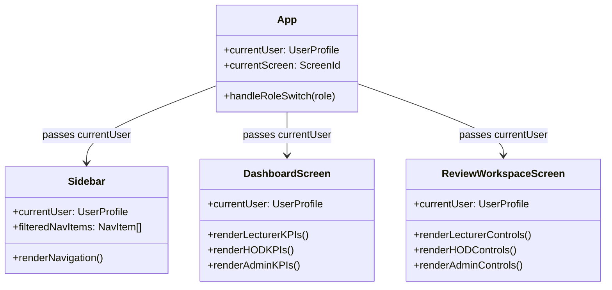

# ĐẶC TẢ YÊU CẦU KỸ THUẬT (TECHNICAL SPECIFICATION)
## PHÂN HỆ PHÂN QUYỀN TRẢI NGHIỆM ĐA VAI TRÒ (ROLE-BASED ACCESS CONTROL - RBAC UI)
**Mã tài liệu:** `SPEC-FE-RBAC-2026-v1.0`  
**Dự án:** QuizGen AI – Nền tảng Khởi tạo Đề thi Học thuật & Khảo thí Trực tuyến  
**Phân hệ:** Frontend Application & User Experience Layer  
**Tác giả phê duyệt:** Hồ Anh Vũ (Leader / System Architect)  
**Nhân sự thực thi:** Bích Đặng Bảo Hân (FE Core/Nav), Huỳnh Hồ Hiệu Hiệu (FE Workspace/Review)  
**Ngày ban hành:** 11/11/2026  
**Trạng thái:** Official Release (Ready for Implementation)  

---

## 1. TỔNG QUAN & BỐI CẢNH KỸ THUẬT (CONTEXT & OBJECTIVES)

### 1.1. Vấn đề Hiện trạng (As-Is Architecture)
Hệ thống QuizGen AI v2.4 đã triển khai thành công cơ chế chuyển đổi thông tin tài khoản đa vai trò tại `src/components/TopHeader.tsx` và lưu trữ đối tượng `UserProfile` (`role: 'lecturer' | 'head_of_department' | 'admin'`) trong `localStorage` và `src/App.tsx`. 

Tuy nhiên, ở tầng giao diện (Presentation Layer), toàn bộ 5 màn hình (`Dashboard`, `Upload`, `Generate`, `Review`, `Bank`) đang được render đồng nhất cho cả 3 vai trò. Điều này dẫn đến sự thiếu hụt tính phân định nghiệp vụ (Separation of Concerns), không phản ánh đúng quy trình Khảo thí thực tế của các cơ sở giáo dục đại học và chưa thỏa mãn tiêu chuẩn đánh giá hệ thống phân quyền (RBAC) của Hội đồng chuyên môn.

### 1.2. Mục tiêu Kỹ thuật (To-Be Architecture)
Triển khai cơ chế **Role-Based Dynamic View Adapter** tại Frontend nhằm:
1. **Lọc cây điều hướng động (Dynamic Navigation):** Sidebar tự động ẩn/hiển thị các phân hệ tương ứng đúng quyền hạn và phạm vi nghiệp vụ của vai trò đang đăng nhập.
2. **Cá nhân hóa Bảng điều khiển (Role-Specific Dashboard):** Hiển thị hệ thống chỉ số KPI, ma trận thống kê học thuật và các lối tắt nghiệp vụ phù hợp với từng nhóm người dùng.
3. **Phân cấp Thao tác Không gian Kiểm duyệt (Workflow Action Gating):** Chuyển dịch trạng thái duyệt đề thi từ mô hình phẳng sang mô hình vòng đời đa cấp: *Giảng viên soạn ➔ Trưởng bộ môn thẩm định & khóa đề ➔ Quản trị Khảo thí đóng gói in ấn OMR & Canvas LMS*.

---

## 2. MA TRẬN PHÂN QUYỀN CHỨC NĂNG (RBAC PERMISSION MATRIX)

| Mã Phân hệ | Màn hình / Tính năng chi tiết | Giảng viên (`lecturer`) | Trưởng bộ môn (`head_of_department`) | Quản trị Khảo thí (`admin`) | Ghi chú Ràng buộc Kỹ thuật |
| :---: | :--- | :---: | :---: | :---: | :--- |
| **SCR-01** | **Bảng điều khiển (Dashboard)** | 🟢 Read-Only (Cá nhân) | 🟢 Read-Only (Bộ môn) | 🟢 Read-Only (Hệ thống) | Thống kê thích ứng theo `currentUser.role` |
| **SCR-02** | **Quản lý Giáo trình (Upload RAG)** | 🟢 Full Access | 🔴 Hidden | 🔴 Hidden | TBM & Admin không thực hiện nạp tài liệu thô |
| **SCR-03** | **Khởi tạo Đề thi AI (Generate)** | 🟢 Full Access | 🔴 Hidden | 🔴 Hidden | Giảng viên là người trực tiếp định hình ma trận đề |
| **SCR-04** | **Không gian Kiểm duyệt (Review)** | 🟡 View + Biên tập + Nộp đề | 🟡 View + Duyệt HOD + Trộn đề | 🟡 View-Only + Xuất OMR/QTI | Nút thao tác chuyển biến theo vai trò |
| **SCR-05** | **Ngân hàng Câu hỏi (Question Bank)** | 🟢 Xem câu hỏi cá nhân | 🟢 Xem ngân hàng bộ môn | 🟢 Xem toàn bộ ngân hàng trường | Lọc theo namespace dữ liệu |
| **ACT-01** | **Chỉnh sửa nội dung câu hỏi** | 🟢 Cho phép (Ghi Audit Log) | 🟡 Cho phép (Kèm ghi chú) | 🔴 Khóa chỉnh sửa (Chống sai lệch) | Kiểm soát tính toàn vẹn khảo thí |
| **ACT-02** | **Phê duyệt đề thi cấp Bộ môn** | 🔴 Không có quyền | 🟢 Quyền quyết định | 🔴 Không can thiệp chuyên môn | Chỉ TBM mới được khóa ma trận đề |
| **ACT-03** | **Xuất bản Đề thi Word (.docx)** | 🟢 Bản nháp (Watermark) | 🟢 Đề chính thức bộ môn | 🟢 Lưu trữ phòng đào tạo | Đóng gói qua Exam Service |
| **ACT-04** | **Xuất bản PDF OMR & Gói Canvas** | 🔴 Không có quyền | 🔴 Không có quyền | 🟢 Độc quyền Khảo thí | Ngăn chặn rò rỉ đề thi và phiếu chấm máy |

---

## 3. ĐẶC TẢ THIẾT KẾ & YÊU CẦU TRIỂN KHAI COMPONENT



### 3.1. Phân hệ Điều phối Cây Menu (`src/components/Sidebar.tsx`)
* **Phụ trách:** Bích Đặng Bảo Hân
* **Yêu cầu kỹ thuật:**
  * Khai báo giao diện lọc danh mục `filteredNavItems` phụ thuộc vào `currentUser.role`.
  * **Cấu hình menu hiển thị:**
    1. `role === 'lecturer'`:
       * `dashboard` (Bảng điều khiển cá nhân)
       * `upload` (Quản lý Giáo trình & Tri thức RAG)
       * `generate` (Khởi tạo Đề thi AI)
       * `review` (Không gian Đối soát & Kiểm duyệt)
       * `bank` (Ngân hàng Đề thi Cá nhân)
    2. `role === 'head_of_department'`:
       * `dashboard` (Thống kê Tiến độ & Chuẩn đầu ra Bộ môn)
       * `review` (Thẩm định Đề thi & Phê duyệt HOD)
       * `bank` (Ngân hàng Câu hỏi & Đề thi Bộ môn)
    3. `role === 'admin'`:
       * `dashboard` (Giám sát Quota AI & Sức khỏe Hệ thống)
       * `review` (Không gian Đóng gói & Rà soát Khảo thí)
       * `bank` (Ngân hàng Dữ liệu Khảo thí Tập trung)
  * Khi chuyển role, nếu màn hình hiện tại không thuộc danh mục được phép của role mới, tự động điều hướng an toàn về `dashboard`.

### 3.2. Phân hệ Bảng Điều khiển Đa biến (`src/components/DashboardScreen.tsx`)
* **Phụ trách:** Bích Đặng Bảo Hân
* **Yêu cầu kỹ thuật:**
  * Nhận prop `currentUser: UserProfile | null`.
  * Hiển thị nhóm 4 thẻ KPI động (Stat Cards) theo cấu trúc:
    * **Giảng viên:** 
      * Thẻ 1: *Giáo trình đã nạp* (Ví dụ: 3 tài liệu)
      * Thẻ 2: *Tổng câu hỏi đã tạo* (Ví dụ: 48 câu)
      * Thẻ 3: *Câu hỏi chờ đối soát* (Badge cảnh báo vàng)
      * Thẻ 4: *Đề thi nháp đã lưu*
    * **Trưởng bộ môn:**
      * Thẻ 1: *Đề thi chờ phê duyệt* (Action Required)
      * Thẻ 2: *Độ phủ chuẩn đầu ra (Bloom)* (Tỷ lệ % cân bằng)
      * Thẻ 3: *Giảng viên đã nộp đề* (Tỷ lệ hoàn thành bộ môn)
      * Thẻ 4: *Ngân hàng đề thi bộ môn*
    * **Quản trị Khảo thí:**
      * Thẻ 1: *Quota AI còn lại* (Hạn mức Gemini / Phút)
      * Thẻ 2: *Số bản ghi Audit Logs hôm nay* (Truy vết biến động)
      * Thẻ 3: *Đề thi đã đóng gói OMR* (Sẵn sàng in ấn)
      * Thẻ 4: *Trạng thái cụm 8 Microservices* (100% Healthy)

### 3.3. Phân hệ Không gian Kiểm duyệt & Phê duyệt (`src/components/ReviewWorkspaceScreen.tsx`)
* **Phụ trách:** Huỳnh Hồ Hiệu Hiệu
* **Yêu cầu kỹ thuật:**
  * Nhận prop `currentUser: UserProfile | null`.
  * **Khu vực Thanh điều phối Tác vụ (Action Control Bar):**
    * **Với Giảng viên:**
      * Nút `[Chỉnh sửa nhanh]`, `[Đổi Bloom]`, `[Xem trích dẫn RAG]`.
      * Nút hành động chính: **`[Gửi nộp đề thi lên Bộ môn]`** (Chuyển trạng thái sang `submitted_to_hod`) kèm Toast thông báo thành công.
      * Nút phụ: **`[Tải bản nháp Word]`** (File có gắn cờ Draft).
    * **Với Trưởng bộ môn:**
      * Nút `[Phê duyệt Học thuật - HOD Approved]` (Màu xanh Emerald, chuyển câu hỏi sang trạng thái `approved`).
      * Nút `[Yêu cầu Giảng viên Hiệu chỉnh]` (Màu đỏ/cam, hiển thị dialog nhập lý do phản hồi).
      * Nút đặc quyền: **`[Khóa Đề thi & Trộn 4 Mã đề]`** (Kích hoạt thuật toán Fisher-Yates sinh các mã đề 101, 102, 103, 104).
    * **Với Quản trị Khảo thí:**
      * Vô hiệu hóa tính năng inline edit câu hỏi (Read-Only Mode) để bảo toàn bằng chứng học thuật.
      * Nút đặc quyền Khảo thí: **`[Xuất bản Đề thi PDF + Phiếu OMR 50 câu]`** (Tải file chuẩn máy quét).
      * Nút đặc quyền LMS: **`[Xuất gói E-Learning ZIP QTI 2.1]`** (Nhập tự động vào Canvas LMS / Moodle).

---

## 4. QUY TRÌNH LUỒNG DỮ LIỆU & VÒNG ĐỜI TRẠNG THÁI (STATE LIFECYCLE)

```
[Giảng viên: Sinh đề AI] 
       │ 
       ▼
(Trạng thái: PENDING_REVIEW) ─── Giảng viên chỉnh sửa & đối soát RAG
       │
       ▼ [Giảng viên: Nộp đề lên Bộ môn]
(Trạng thái: SUBMITTED_TO_HOD)
       │
       ├─────────────────────────────────┐
       ▼ [Trưởng bộ môn: Duyệt đạt]      ▼ [Trưởng bộ môn: Yêu cầu sửa]
(Trạng thái: HOD_APPROVED)         (Trạng thái: REJECTED_WITH_FEEDBACK)
       │                                  │
       │                                  └─► Quay lại Giảng viên sửa
       ▼ [Trưởng bộ môn: Khóa & Trộn mã đề]
(Trạng thái: LOCKED_FOR_EXAM)
       │
       ▼ [Khảo thí: Xuất bản OMR 50 câu & Canvas QTI 2.1]
(Trạng thái: PUBLISHED / ARCHIVED)
```

---

## 5. KẾ HOẠCH PHÂN BỔ NHIỆM VỤ & TIÊU CHÍ NGHIỆM THU (ACCEPTANCE CRITERIA)

### Task 1: Giao diện Điều hướng & Bảng điều khiển Đa vai trò (Assignee: Bích Đặng Bảo Hân)
* [ ] **AC-1.1:** Cập nhật `src/components/Sidebar.tsx`: Khi đổi sang Trưởng bộ môn hoặc Khảo thí, menu Sidebar chỉ hiển thị đúng các mục được phép trong Ma trận Phân quyền tại Mục 2.
* [ ] **AC-1.2:** Cập nhật `src/components/DashboardScreen.tsx`: Hiển thị đúng 4 nhóm chỉ số KPI riêng biệt cho từng vai trò (`lecturer`, `head_of_department`, `admin`).
* [ ] **AC-1.3:** Đảm bảo responsive, hiệu ứng chuyển đổi mượt mà, giữ vững phong cách thiết kế Cyber Dark Glassmorphism chuẩn của dự án.

### Task 2: Điều phối Thao tác Không gian Kiểm duyệt & Phê duyệt (Assignee: Huỳnh Hồ Hiệu Hiệu)
* [ ] **AC-2.1:** Cập nhật `src/components/ReviewWorkspaceScreen.tsx`: Ẩn/hiện chính xác hệ thống nút bấm hành động theo từng vai trò (Nộp đề ➔ Duyệt HOD / Trộn đề ➔ Xuất bản OMR / QTI).
* [ ] **AC-2.2:** Khóa tính năng chỉnh sửa text câu hỏi khi người dùng đăng nhập dưới vai trò `admin` (Quản trị Khảo thí).
* [ ] **AC-2.3:** Kiểm tra lệnh gọi Binary Blob tải file Word/PDF hoạt động an toàn không phát sinh lỗi trình duyệt.

### Tiêu chuẩn Nghiệm thu Kỹ thuật chung:
* Chạy lệnh `npm run build` đạt kết quả: **0 errors, 0 warnings (TypeScript Clean Build)**.
* Kiểm thử chuyển đổi luân phiên cả 3 vai trò tại Header mà không làm phát sinh lỗi vỡ layout hoặc sập ứng dụng.
* Thời hạn hoàn thành: **Trong ngày 11/11/2026** để phục vụ tổng hợp báo cáo tiến độ Tuần 3.

---
*(Tài liệu lưu hành nội bộ nhóm phát triển QuizGen AI – Vui lòng không sao chép ngoài phạm vi đồ án)*
