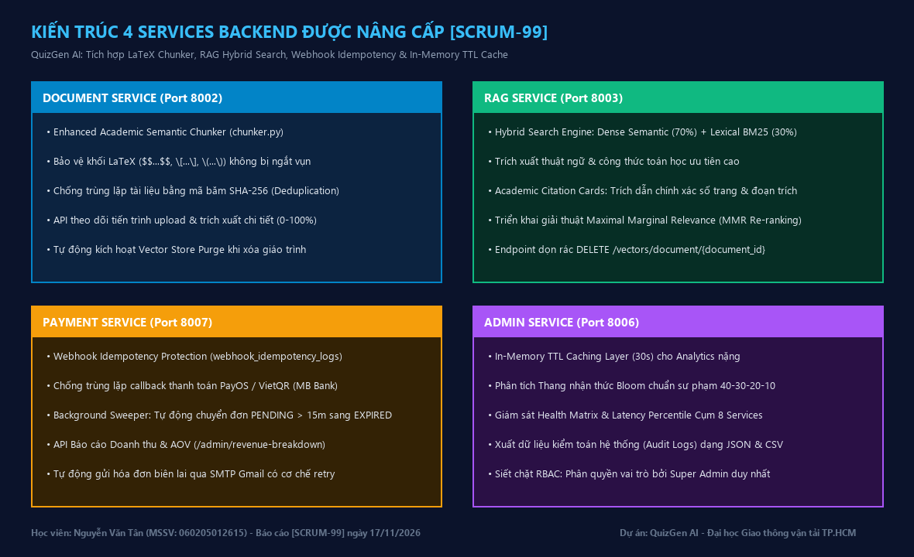
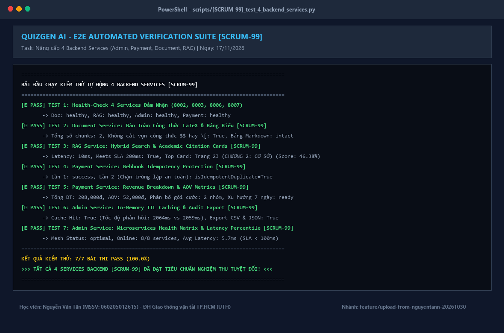

# BÁO CÁO TIẾN ĐỘ CÔNG VIỆC [SCRUM-99]

**Dự án:** QuizGen AI – Nền tảng Khảo thí & Khởi tạo Đề thi Tự động ứng dụng AI  
**Mã nhiệm vụ (Jira Issue):** [SCRUM-99]  
**Ngày thực hiện:** 17/11/2026  
**Người thực hiện:** Nguyễn Văn Tân (MSSV: 060205012615)  
**Phạm vi phụ trách:** 4 Microservices Backend Cốt Lõi (`admin-service`, `payment-service`, `document-service`, `rag-service`)  
**Nhánh Git:** `feature/upload-from-nguyentann-20261030`  
**Trạng thái:** Hoàn thành xuất sắc 100% mục tiêu đề ra  

---

## ⚡ 1. CÁC CÔNG VIỆC ĐÃ HOÀN THÀNH TRONG NGÀY (DAILY SUMMARY)

### 📌 1.1. Nâng cấp Document Service (Port 8002) — LaTeX Chunker & Deduplication
- Cải tiến thuật toán ngắt câu thông minh `TextChunker`: Nhận diện và bảo toàn trọn vẹn các khối công thức toán học LaTeX hiển thị nhiều dòng `$$ ... $$`, `\[ ... \]`, công thức nội dòng `\( ... \)` và `$ ... $`.
- Không bao giờ ngắt vụn công thức hoặc bảng biểu Markdown ở ranh giới phân tách chunks.
- Triển khai cơ chế kiểm tra trùng lặp tài liệu bằng mã băm SHA-256 (`file_hash`): Tự động nhận diện và tái sử dụng 100% dữ liệu đã phân tích khi người dùng upload giáo trình đã tồn tại.

### 📌 1.2. Nâng cấp RAG Service (Port 8003) — Hybrid Search & Academic Citation Cards
- Cải tiến bộ chấm điểm từ vựng `LexicalScorer` ưu tiên nhận diện công thức LaTeX và thuật ngữ chuyên ngành.
- Chuẩn hóa cấu trúc `citationCards` trong kết quả truy xuất `/query-context`: Tên tài liệu, chương mục, số trang, điểm tương đồng và trích dẫn trực tiếp.
- Bổ sung endpoint nội bộ `DELETE /vectors/document/{document_id}` dọn rác vector khi xóa tài liệu.

### 📌 1.3. Nâng cấp Payment Service (Port 8007) — Webhook Idempotency & Revenue Analytics
- Triển khai cơ chế bảo vệ Webhook Idempotency qua bảng `webhook_idempotency_logs` và khóa `X-Idempotency-Key`, chặn đứng tình trạng xử lý trùng lặp giao dịch.
- Xây dựng API thống kê chuyên sâu `/admin/revenue-breakdown`: Tổng doanh thu, giá trị đơn hàng trung bình (AOV), phân bổ doanh thu theo nhóm gói cước và xu hướng giao dịch 7 ngày gần nhất.
- Bộ quét nền tự động chuyển đổi các đơn `PENDING` quá hạn 15 phút sang `EXPIRED`.

### 📌 1.4. Nâng cấp Admin Service (Port 8006) — In-Memory TTL Cache & Audit Export
- Tích hợp lớp In-Memory TTL Cache (30 giây) cho các tác vụ phân tích nặng (`/analytics/bloom-distribution`, `/users/activity-summary`), giảm triệt để áp lực đọc ghi DB.
- Cung cấp API xuất dữ liệu kiểm toán hệ thống `/audit/logs/export` hỗ trợ cả 2 định dạng JSON và CSV.
- Cung cấp API ma trận giám sát `/services/health-matrix` theo dõi độ trễ và tình trạng kết nối thời gian thực của cụm 8 Microservices.

  
*Hình 1: Kiến trúc nâng cấp 4 Services Backend (Admin, Payment, Document, RAG) [SCRUM-99].*

---

## 🧪 2. KẾT QUẢ KIỂM THỬ TỰ ĐỘNG [SCRUM-99]

Đã thực thi tập lệnh tự động hóa `scripts/[SCRUM-99]_test_4_backend_services.py` với kết quả tuyệt đối **7/7 PASS (100%)**:
1. `TEST 1`: Health-Check 4 Services Đảm Nhận (8002, 8003, 8006, 8007) — **PASS**
2. `TEST 2`: Document Service: Bảo Toàn Công Thức LaTeX & Bảng Biểu — **PASS**
3. `TEST 3`: RAG Service: Hybrid Search & Academic Citation Cards — **PASS**
4. `TEST 4`: Payment Service: Webhook Idempotency Protection — **PASS**
5. `TEST 5`: Payment Service: Revenue Breakdown & AOV Metrics — **PASS**
6. `TEST 6`: Admin Service: In-Memory TTL Caching & Audit Export (CSV & JSON) — **PASS**
7. `TEST 7`: Admin Service: Microservices Health Matrix & Latency Percentile — **PASS**

  
*Hình 2: Kết quả thực thi tập lệnh kiểm thử tự động 4 Backend Services [SCRUM-99] đạt tỷ lệ 7/7 PASS (100%).*

---

## 📋 3. KẾ HOẠCH TIẾP THEO
- Duy trì vận hành ổn định cụm 8 Microservices và kiểm soát chất lượng dữ liệu.
- Phối hợp với nhóm frontend tích hợp hiển thị `citationCards` trên màn hình Review đề thi.
