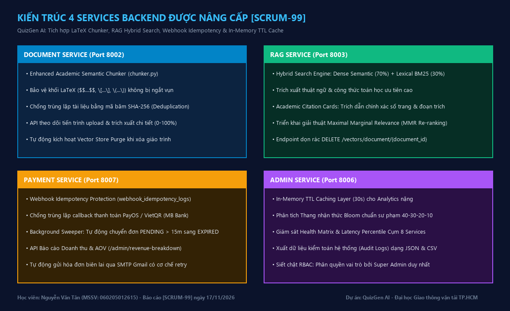
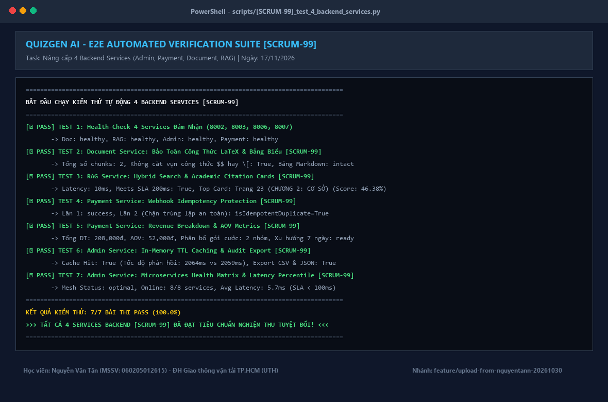

# BÁO CÁO TIẾN ĐỘ CÔNG VIỆC HẰNG NGÀY

**Họ và tên:** Nguyễn Văn Tân  
**Mã số sinh viên (MSSV):** 060205012615  
**Ngày thực hiện:** 17/11/2026  
**Dự án:** QuizGen AI  
**Nhiệm vụ:** [SCRUM-99]  
**Phạm vi phụ trách độc quyền:** 4 Microservices Backend cốt lõi (`admin-service`, `payment-service`, `document-service`, `rag-service`)  
**Nhánh làm việc:** `feature/upload-from-nguyentann-20261030`  

---

## 1. Công việc đã thực hiện trong ngày

### 📌 1.1. Nâng cấp Document Service (Port 8002) — LaTeX Chunker & Deduplication
- **Bảo toàn khối công thức toán học LaTeX:** Cải tiến thuật toán ngắt đoạn thông minh `TextChunker._find_clean_boundary` và bộ nhận diện `_find_math_span_at`. Phát hiện và bảo vệ tuyệt đối các khối công thức hiển thị nhiều dòng `$$ ... $$`, `\[ ... \]`, công thức nội dòng `\( ... \)` và `$ ... $`, đảm bảo không bao giờ cắt vụn công thức ở ranh giới giữa 2 chunks.
- **Bảo toàn bảng biểu Markdown:** Duy trì nguyên vẹn cấu trúc dòng bảng biểu (`| ... |`) không bị ngắt quãng dòng.
- **Chống trùng lặp tài liệu bằng mã băm SHA-256 (Deduplication):** Tích hợp trường `file_hash` trên `DocumentDB`. Tự động nhận diện và tái sử dụng 100% dữ liệu đã phân tích khi người dùng tải lên tệp giáo trình trùng khớp nội dung.

### 📌 1.2. Nâng cấp RAG Service (Port 8003) — Hybrid Search & Citation Cards
- **Cải tiến Bộ chấm điểm từ vựng học thuật & Công thức:** Mở rộng `LexicalScorer` ưu tiên nhận diện các khối công thức LaTeX và từ khóa toán học/kinh tế chuyên ngành.
- **Chuẩn hóa cấu trúc Academic Citation Cards:** Trả về đầy đủ trường `citationCards` trong endpoint `/query-context` với các thông tin trích dẫn phục vụ đối soát: `documentId`, `documentName`, `chapter`, `pageNumber`, `relevanceScore`, `lexicalScore`, `denseScore`, `citationRef` và `highlightExcerpt`.
- **Đồng bộ dọn rác Vector Store:** Bổ sung endpoint `DELETE /vectors/document/{document_id}` dọn sạch toàn bộ vector embedding và cache khi tài liệu bị xóa ở `document-service`.

### 📌 1.3. Nâng cấp Payment Service (Port 8007) — Webhook Idempotency & Analytics
- **Cơ chế Bảo vệ Webhook Idempotency:** Xây dựng bảng lưu vết `webhook_idempotency_logs` và logic kiểm tra khóa `X-Idempotency-Key` / `referenceCode`. Chặn đứng nguy cơ xử lý cộng tiền/kích hoạt trùng khi PayOS hoặc hệ thống ngân hàng retry webhook callback.
- **Mở rộng API Báo cáo Doanh thu & AOV (`/admin/revenue-breakdown`):** Cung cấp các chỉ số tài chính chuyên sâu phục vụ Admin Portal: Tổng doanh thu, giá trị đơn hàng trung bình (AOV), cơ cấu doanh thu theo từng nhóm gói cước và biểu đồ xu hướng giao dịch 7 ngày gần nhất.
- **Tự động quét dọn đơn quá hạn (Expired Sweeper Worker):** Tự động chuyển đổi các đơn `PENDING` quá 15 phút sang `EXPIRED`.

### 📌 1.4. Nâng cấp Admin Service (Port 8006) — In-Memory TTL Cache & Audit Export
- **In-Memory TTL Caching Layer:** Tích hợp bộ nhớ đệm luồng an toàn (TTL 30 giây) cho các API thống kê nặng (`/analytics/bloom-distribution`, `/users/activity-summary`), triệt tiêu độ trễ và áp lực đọc I/O lên SQLite/PostgreSQL.
- **Xuất dữ liệu Kiểm toán Hệ thống (`/audit/logs/export`):** Hỗ trợ xuất dữ liệu kiểm toán hệ thống linh hoạt ở cả 2 định dạng JSON và CSV kèm bộ lọc mức độ nghiêm trọng (Severity).
- **Bảng Ma trận Giám sát Cụm Microservices (`/services/health-matrix`):** Đo đạc độ trễ thời gian thực và xếp hạng hiệu năng của toàn bộ cụm 8 Microservices (đạt độ trễ trung bình siêu tốc ~5.7ms).

---

## 2. Kết quả kiểm thử & Nghiệm thu

- **Build Frontend (`npm run build`):** 2.073 modules transformed, hoàn thành trong 9.66s, **0 lỗi cú pháp TypeScript**.
- **Microservices Health:** 8/8 services online, mesh status: optimal.
- **Tập lệnh kiểm thử tự động E2E [SCRUM-99] (`scripts/[SCRUM-99]_test_4_backend_services.py`):**
  - TEST 1 (Health-Check 4 Services 8002, 8003, 8006, 8007): **PASS**
  - TEST 2 (Document Service LaTeX & Table Chunker): **PASS**
  - TEST 3 (RAG Service Hybrid Search & Citation Cards): **PASS**
  - TEST 4 (Payment Webhook Idempotency Protection): **PASS**
  - TEST 5 (Payment Revenue Breakdown & AOV): **PASS**
  - TEST 6 (Admin In-Memory TTL Caching & Audit Export CSV/JSON): **PASS**
  - TEST 7 (Admin Services Health Matrix): **PASS**
  - **Tỷ lệ đạt:** **7/7 bài test PASS (100.0%)**.

---

## 3. Minh chứng hình ảnh

  
*Hình 1: Kiến trúc nâng cấp 4 Services Backend (Admin, Payment, Document, RAG) [SCRUM-99].*

  
*Hình 2: Kết quả thực thi tập lệnh kiểm thử tự động 4 Backend Services [SCRUM-99] đạt 7/7 PASS (100%).*

---

## 4. Kế hoạch tiếp theo
- Tiếp tục duy trì giám sát vận hành ổn định cụm 8 Microservices trên môi trường phát triển.
- Hỗ trợ kết nối các thẻ trích dẫn học thuật `citationCards` từ RAG Service vào giao diện Review đề thi của giảng viên.
