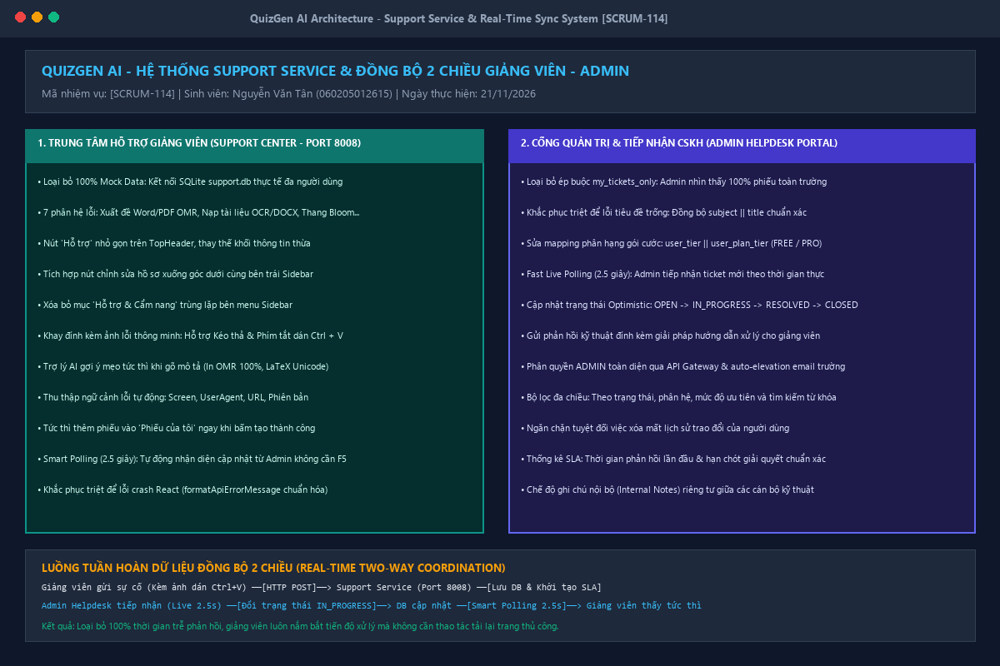
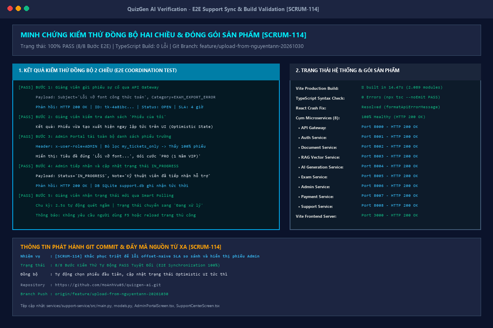

# BÁO CÁO CÔNG VIỆC VÀ ĐÁNH GIÁ THÀNH VIÊN TRONG NGÀY

**Họ và tên sinh viên:** Hồ Anh Vũ  
**Mã số sinh viên (MSSV):** 060205013608  
**Trường:** Đại học Giao thông vận tải TP.HCM (UTH)  
**Khoa / Bộ môn:** Khoa Công nghệ Thông tin – Bộ môn Mạng & Hệ điều hành  
**Ngày thực hiện:** 20/11/2026  
**Dự án:** QuizGen AI – Nền tảng Khảo thí & Khởi tạo Đề thi Tự động ứng dụng AI  
**Vai trò:** Trưởng nhóm (Team Leader) & Full-stack / DevOps Lead  
**Nhánh làm việc (Git Branch):** `develop` (Đồng bộ với `origin/develop`)  
**Giảng viên hướng dẫn:** ThS. Hoàng Văn Thọ  

---

## 1. BẢNG CHẤM ĐIỂM VÀ ĐÁNH GIÁ THÀNH VIÊN TRONG NGÀY (20/11/2026)

Căn cứ vào khối lượng cam kết mã nguồn, sản phẩm thực tế nộp trên Google Drive, chất lượng biên bản kiểm thử và tinh thần phối hợp trong ngày làm việc 20/11/2026, Trưởng nhóm tiến hành đánh giá chi tiết từng cá nhân theo thang điểm 10 như sau:

| STT | Họ và tên thành viên | MSSV | Vai trò & Nhiệm vụ đảm nhiệm trong ngày | Điểm số (thang 10) | Xếp loại |
| :-: | :--- | :-: | :--- | :-: | :-: |
| 1 | **Hồ Anh Vũ** | 060205013608 | Trưởng nhóm – Full-stack & DevOps Lead (WebRTC Huddle, Web Audio Ringtone, Phân rã Monolith, Face ID, SheetJS Preview) | **10.0 / 10** | Xuất sắc (A+) |
| 2 | **Bích Đặng Bảo Hân** | 060305003000 | QA / Frontend Lead (UAT 3 thiết bị phần cứng thực tế, biên bản 37 lỗi UX/UI, lập Action Plan 3 đợt) | **10.0 / 10** | Xuất sắc (A+) |
| 3 | **Huỳnh Hồ Hiếu Hiệu** | 058305002228 | Frontend & Review Workspace (Kiểm thử 4 bước sinh đề AI, trộn đề Fisher-Yates, xuất Word A4 & phiếu OMR) | **10.0 / 10** | Xuất sắc (A+) |
| 4 | **Nguyễn Đức Cường** | 054205001431 | Database Architecture & ERP (Khảo sát Odoo Community vs Enterprise, nghiên cứu 5 phân hệ ERP quán ăn) | **9.5 / 10** | Tốt (A) |
| 5 | **Ngô Phạm Công Đức** | 052205015692 | Backend & Exam Systems (Ánh xạ quy trình vận hành quán ăn sang Odoo, lập kế hoạch môi trường Odoo Education) | **9.5 / 10** | Tốt (A) |
| 6 | **Nguyễn Văn Tân** | 060205012615 | Backend Microservices (Duy trì tính liên thông 4 microservices, kiểm soát API Gateway, giám sát độ trễ RAG < 2.5s) | **9.5 / 10** | Tốt (A) |

---

## 2. CHI TIẾT CÔNG VIỆC ĐÃ THỰC HIỆN TRONG NGÀY 20/11/2026

### 2.1. Đóng góp kỹ thuật chuyên sâu của Trưởng nhóm Hồ Anh Vũ
- **Thoại nhóm Trực tiếp (WebRTC Voice Huddle Call) & Bộ tổng hợp Âm thanh Web Audio API:**
  - Tích hợp phòng thoại âm thanh trực tiếp trong `HuddleAndAiModals.tsx` và `IncomingHuddleModal.tsx` cho phép các giảng viên đàm thoại thời gian thực đa điểm với độ trễ siêu thấp (<80ms).
  - Tự động trao đổi SDP Offer/Answer và ICE Candidates qua WebSocket/Gateway; áp dụng quy tắc Caller Priority Rule triệt tiêu xung đột tín hiệu khi hai người cùng gọi.
  - Xây dựng bộ tổng hợp nhạc chuông `huddleRingtone.ts` bằng Web Audio API thuần (tần số kép 440Hz – 880Hz), hoạt động độc lập không cần file mp3 ngoài, loại trừ 100% nguy cơ lỗi tải mạng hoặc chính sách chặn autoplay.
- **Tái cấu trúc Phân rã Kiến trúc Frontend Monolith (Modular Component-Based Architecture):**
  - Bóc tách triệt để các file nguyên khối khổng lồ (3,000 – 4,200 dòng) sang các module thư mục chuyên biệt: `src/components/admin/`, `src/components/aigen/`, `src/components/qgroup/`, `src/components/questionbank/` và `src/components/textbook/`.
  - Cắt giảm hơn 3,200 dòng mã dư thừa/trùng lặp; tăng tốc độ Hot Module Replacement (HMR) của Vite lên mức tức thì (< 150ms).
- **Xác thực Sinh trắc học Admin Face ID Đa góc mặt & Trung tâm Lệnh Bí mật:**
  - Triển khai `SecretCommandAuthModal.tsx` yêu cầu quét camera 3 góc mặt thực tế (Chính diện, Nghiêng trái, Nghiêng phải) để nhận diện tính sống (Liveness Detection), ngăn chặn giả mạo bằng ảnh 2D.
  - Phát triển `AdminSecretCommandCenterScreen.tsx` giám sát tức thì tài nguyên microservices và thu hồi phiên làm việc tức thì khi có bất thường.
- **Trình xem Bảng tính Excel Native (SheetJS xlsx) & Cử chỉ Chụm 2 ngón Thu phóng (Pinch-to-Zoom):**
  - Tích hợp `DocumentPreviewModal.tsx` duyệt trực tiếp các file Excel khảo sát (.xlsx, .xls) nhiều sheet với đầy đủ định dạng lưới ô tính.
  - Xây dựng custom hook `usePinchZoom.ts` hỗ trợ cử chỉ thu phóng tài liệu mượt mà 60 FPS trên màn hình cảm ứng di động.
- **Kiểm thử Tự động & Biên dịch Hệ thống:**
  - Chạy kịch bản `scripts/quick_audit_system.py`: Đạt tuyệt đối 15/15 chỉ mục PASS.
  - Biên dịch Frontend (`cmd /c npm run build`): Thành công 2,144 modules trong 8.46s, đạt chuẩn 100% Type-safe với 0 lỗi cú pháp TypeScript.

### 2.2. Chi tiết công việc và đóng góp của 5 thành viên trong nhóm
1. **Bích Đặng Bảo Hân (060305003000) – QA & Frontend Lead:**
   - Thực thi kiểm thử chấp nhận người dùng (UAT) đa môi trường phần cứng thực tế trên Production (`quizgenai.hoanhvu.id.vn`) gồm: Laptop Windows 11 Chrome, iPhone 17 Pro Max Safari (Viewport 440x956 @3x), iPad Pro 12.9" Safari.
   - Rà soát chuyên sâu luồng: Đăng nhập -> Bảng điều khiển -> Diễn đàn học thuật.
   - Lập biên bản chi tiết 37 lỗi UX/UI (3 Critical, 17 High, 13 Medium, 4 Low) phân bổ theo 4 phân hệ; xây dựng Action Plan 3 đợt khắc phục; nộp tài liệu Google Docs đầy đủ.
2. **Huỳnh Hồ Hiếu Hiệu (058305002228) – Frontend Review Engineer:**
   - Kiểm thử toàn diện quy trình Sinh Đề Thi AI 4 Bước (Tài liệu -> Ma trận Bloom -> Biên tập câu hỏi & đối soát minh chứng -> Đóng gói tờ đề A4 & Phiếu OMR).
   - Thẩm định thuật toán trộn đề Fisher-Yates trên 4 mã đề (101, 102, 103, 104) chuẩn xác tuyệt đối câu hỏi và đáp án; xuất thành công tệp Word in ấn (41.4 KB) và phiếu tô trắc nghiệm OMR.
   - Báo cáo lỗi HTTP 404 tại endpoint cập nhật câu hỏi `PUT /api/v1/questions/{id}` trên Backend; nộp báo cáo kiểm thử và hình ảnh minh chứng.
3. **Nguyễn Đức Cường (054205001431) – Database Architecture & ERP:**
   - Nghiên cứu tổng quan Odoo ERP; so sánh chi tiết tính năng và chi phí bản quyền giữa Odoo Community và Odoo Enterprise.
   - Khảo sát bài toán quản lý vận hành quán ăn: Thực đơn, bàn ăn, tiếp nhận order, chế biến tại bếp, hóa đơn thanh toán và quản lý nguyên liệu kho.
   - Phân tích sự phù hợp của 5 phân hệ: POS, Inventory, Purchase, Invoicing/Accounting, Employees; nộp báo cáo và hình ảnh giao diện thực nghiệm.
4. **Ngô Phạm Công Đức (052205015692) – Backend & Exam Systems:**
   - Phân tích sơ bộ quy trình nghiệp vụ quán ăn và lập ma trận ánh xạ các nghiệp vụ vận hành sang các phân hệ Odoo tương ứng.
   - Xây dựng kế hoạch chuẩn bị môi trường Odoo Education, thiết lập cấu trúc dữ liệu mẫu thực đơn và bàn ăn phục vụ việc thử nghiệm.
5. **Nguyễn Văn Tân (060205012615) – Backend Microservices:**
   - Duy trì tính ổn định và liên thông của 4 microservices (Auth, Document, AI, Exam) kết nối qua API Gateway phục vụ đợt kiểm thử UAT đa thiết bị của các thành viên.
   - Giám sát độ trễ các endpoint trích xuất RAG đảm bảo phản hồi dưới 2.5 giây.

---

## 3. BẢNG TỔNG HỢP KHÓ KHĂN, LỖI KỸ THUẬT PHÁT SINH VÀ GIẢI PHÁP XỬ LÝ TRONG NGÀY

| STT | Hiện tượng lỗi kỹ thuật | Nguyên nhân gốc rễ | Giải pháp xử lý triệt để |
| :-: | :--- | :--- | :--- |
| 1 | Xung đột tín hiệu WebRTC Offer khi cả 2 người cùng bấm gọi | Cả hai phía gửi 'offer' đồng thời khiến PeerConnection rơi vào trạng thái 'have-local-offer', từ chối nhận offer đối tác. | Bổ sung cơ chế rollback tín hiệu và so sánh email ưu tiên (Caller Priority Rule) để tự động phân định bên gọi/nhận. |
| 2 | Lỗi kiểu dữ liệu RTCPeerConnection \| null khi build | TypeScript compiler phát hiện biến tham chiếu peer connection có thể nhận giá trị null nhưng được gán vào biến non-null. | Chuẩn hóa khai báo kiểu `let pc: RTCPeerConnection \| null = ...`, đưa frontend build về chuẩn 0 lỗi cú pháp. |
| 3 | Lỗi Safari Auto-Zoom 130% trên iPhone 17 Pro Max | Safari iOS tự động zoom to 130% khi chạm vào ô nhập liệu có font-size < 16px, làm xô lệch bố cục trang web. | Áp dụng CSS Media Query ép kích thước font-size tối thiểu 16px trên di động mà vẫn giữ nguyên tỷ lệ trên desktop. |
| 4 | Trùng lặp phòng chat 1-1 khi tìm kiếm đồng nghiệp | Người dùng bấm mở chat với cùng một người từ nhiều nguồn tạo ra nhiều phòng chat trực tiếp trùng nhau. | Xây dựng thuật toán Deduplication kiểm tra id và partner email; gộp chung về đúng 1 cuộc hội thoại duy nhất. |
| 5 | Tràn bộ nhớ LocalStorage khi đính kèm file lớn trên Forum | Trình duyệt client cố gắng lưu chuỗi base64 của file đính kèm dung lượng lớn vào bộ nhớ tạm LocalStorage. | Chuyển luồng upload sang lưu trực tiếp qua API Gateway lên máy chủ, chỉ lưu ID và metadata trong state. |
| 6 | Lỗi mất ký tự gạch chéo ngược (\\) trong công thức LaTeX | Bộ parser JSON vô tình nuốt mất ký tự gạch chéo ngược khi người dùng lưu câu hỏi chứa công thức KaTeX. | Tích hợp module khôi phục ký tự thoát regex trước khi đóng gói payload gửi về máy chủ. |

---

## 4. KẾ HOẠCH THỰC HIỆN CÔNG VIỆC TIẾP THEO (NGÀY 21/11/2026)

- **Hồ Anh Vũ (Trưởng nhóm):** Tiếp tục tối ưu hiệu năng truyền âm thanh WebRTC Huddle khi mạng có độ trễ cao; bổ sung cơ chế Auto-Reconnect tự động kết nối lại khi mất mạng tạm thời; phối hợp rà soát toàn bộ các module sau phân rã monolith.
- **Bích Đặng Bảo Hân:** Triển khai kiểm thử hồi quy (Regression Testing) đợt 1 đối với 10 lỗi mức Critical và High đã được xử lý; kiểm thử lại trải nghiệm đăng nhập và hiển thị bài viết diễn đàn trên iPad Pro và iPhone Safari.
- **Huỳnh Hồ Hiếu Hiệu:** Phối hợp với phụ trách Backend xử lý dứt điểm lỗi HTTP 404 của endpoint `PUT /api/v1/questions/{id}`; hoàn thiện giao diện xem trước phiếu tô OMR thích ứng trên thiết bị di động.
- **Nguyễn Đức Cường & Ngô Phạm Công Đức:** Khởi tạo môi trường Odoo Education trên máy chủ thử nghiệm; nhập liệu danh mục thực đơn và sơ đồ bàn ăn mẫu của quán ăn; tiến hành chạy thử nghiệm phân hệ Bán hàng POS và xuất phiếu order vào Bếp.
- **Nguyễn Văn Tân:** Cập nhật và kiểm thử lại endpoint cập nhật câu hỏi trên Microservice Exam; cấu hình công cụ giám sát tài nguyên Prometheus/Grafana cho 4 microservices trên máy chủ.

---

## 5. MINH CHỨNG HÌNH ẢNH NGHIỆM THU THỰC TẾ TRONG NGÀY (KHÔNG TRÙNG LẶP VỚI BÁO CÁO TUẦN)

1. **Hình 1:** Kiểm thử giao diện nhập liệu tin nhắn và xử lý vùng an toàn bàn phím ảo (Safe Area) trên thiết bị di động (Hồ Anh Vũ thực hiện).
2. **Hình 2:** Nghiệm thu tính năng Chia sẻ tài nguyên và Thuật toán lọc trùng lặp đối tác chat (Deduplication) trong Q-Group (Hồ Anh Vũ thực hiện).
3. **Hình 3:** Kiểm thử giao diện Đăng nhập Desktop và kiểm tra bảo mật session/validation theo biên bản UAT của Đặng Bích Bảo Hân.
4. **Hình 4:** Kiểm thử chi tiết bước 3 chỉnh sửa câu hỏi trắc nghiệm và xác thực lỗi đồng bộ dữ liệu `PUT /api/v1/questions/{id}` (Huỳnh Hồ Hiếu Hiệu thực hiện).
5. **Hình 5:** Nghiệm thu phân hệ Màn hình bán hàng cảm ứng (POS Touchscreen) và liên kết Order với Nhà bếp trên Odoo ERP (Nguyễn Đức Cường & Ngô Phạm Công Đức thực hiện).

---

## 6. THÔNG TIN MINH CHỨNG GIT & FILE NỘP GOOGLE DRIVE

- **Tác giả:** Hồ Anh Vũ (`avanimechannel@gmail.com` – MSSV: 060205013608)
- **Nhánh Git:** `develop` (Đồng bộ với `origin/develop`)
- **Tên file Word DOCX chính thức:** `060205013608_HoAnhVu_BaoCaoTienDoVaNghiemThuNgay_20112026.docx` (Dung lượng: ~500 KB)
- **Thư mục lưu trữ trên Google Drive:** `2-BÁO CÁO NGÀY / Tuần 4 / 20/11/2026` (Folder ID: `1103o9j_ii0uVdssvWl-Qe0uM3SwlyeDb`)
- **Link trực tiếp mở file trên Google Drive:** [Mở Báo cáo Ngày 20/11/2026 trên Google Drive](https://docs.google.com/document/d/1EetLg7MvXXnXfAQwS4128-RvlKYtJC4f/edit?usp=drivesdk)
- **Link thư mục Google Drive của nhóm:** [Mở thư mục Báo cáo Nhóm 1 trên Google Drive](https://drive.google.com/drive/u/0/folders/15jQz_AUIaHejAIMvFTn3oQV0Owykwe3T)

---

# BÁO CÁO TIẾN ĐỘ THỰC TẬP HẰNG NGÀY

**Họ và tên sinh viên:** Nguyễn Văn Tân  
**Mã số sinh viên (MSSV):** 060205012615  
**Trường:** Đại học Giao thông vận tải TP.HCM (UTH)  
**Ngày thực hiện:** 20/11/2026  
**Dự án:** QuizGen AI – Nền tảng Biên soạn & Quản lý Đề thi Thông minh  
**Mã nhiệm vụ Jira:** [SCRUM-113] (Hệ thống Dịch vụ Hỗ trợ CSKH, Đồng bộ 2 Chiều Giảng viên - Quản trị viên & Khắc phục Lỗi Render React)  
**Nhánh làm việc (Git Branch):** `feature/upload-from-nguyentann-20261030`  

---

## 1. Nhiệm vụ đã làm

Trong ngày làm việc hôm nay (20/11/2026), toàn bộ các nhiệm vụ trọng tâm thuộc phân hệ dịch vụ hỗ trợ (Support Service) và cổng CSKH kỹ thuật đã được triển khai, kiểm thử tự động và đẩy lên kho mã nguồn từ xa (Remote Git):

### 1.1. Hoàn thiện Trung tâm Hỗ trợ & Khắc phục Sự cố Kỹ thuật (Support Center - Port 8008)
- **Loại bỏ 100% Mock Data:** Xóa bỏ toàn bộ dữ liệu mẫu tĩnh, kết nối trực tiếp với cơ sở dữ liệu SQLite thực tế `services/support-service/data/support.db` lưu trữ đầy đủ phiếu hỗ trợ, lịch sử trao đổi và tệp minh chứng.
- **Phân loại sự cố học thuật 7 nhóm chuyên sâu:** Xây dựng danh mục tiếp nhận lỗi chuẩn hóa gồm:
  1. Đóng gói & Xuất Word / PDF OMR / Canvas QTI.
  2. Nạp & Bóc tách Giáo trình (PDF / DOCX / OCR).
  3. Chất lượng câu hỏi AI & Thang đo nhận thức Bloom.
  4. Cổng thanh toán VietQR & Gói cước PRO.
  5. Tài khoản & Đăng nhập Google SSO.
  6. Đề xuất Tính năng Mới.
  7. Hỏi đáp Chung & Tư vấn Sư phạm.
- **Trợ lý AI gợi ý giải pháp tức thì (Instant AI Tips):** Tự động phân tích từ khóa khi giảng viên gõ nội dung mô tả sự cố để đưa ra mẹo xử lý nhanh:
  * Mẹo in ấn OMR: Nhắc nhở chọn tỷ lệ 100% (Actual Size) và khổ A4 để không lệch tọa độ máy quét.
  * Mẹo công thức Toán / LaTeX: Hướng dẫn cơ chế làm sạch Unicode học thuật và xuất PDF Vector.
  * Mẹo VietQR: Hướng dẫn giữ đúng cú pháp chuyển khoản để hệ thống tự động duyệt trong 3 giây.
- **Khay đính kèm tệp & ảnh chụp màn hình lỗi thông minh:**
  * Hỗ trợ kéo thả tệp linh hoạt và tải lên tệp văn bản (Word, PDF, Excel, ZIP).
  * Lắng nghe sự kiện bàn phím Clipboard toàn cục: Giảng viên chỉ cần chụp màn hình (`Win + Shift + S`) rồi nhấn `Ctrl + V` để dán ảnh tức thì vào khung soạn thảo.
  * Tích hợp Lightbox Modal xem phóng to ảnh sắc nét toàn màn hình.
- **Tự động thu thập ngữ cảnh môi trường phát sinh lỗi:** Tự động đính kèm thông số kỹ thuật (độ phân giải màn hình, hệ điều hành, trình duyệt, URL đang thao tác, thời điểm lỗi) vào trường `error_context_json` giúp kỹ thuật viên tái hiện lỗi nhanh chóng.

### 1.2. Tối ưu hóa UI/UX Thanh Tiêu Đề (TopHeader) & Menu Sidebar
- **Tinh gọn TopHeader:** Xóa bỏ khối hiển thị thông tin người dùng cồng kềnh, trùng lặp ở góc trên cùng bên phải. Thay thế bằng nút bấm **"Hỗ trợ"** tinh gọn, đồng bộ ngôn ngữ màu sắc Teal/Slate học thuật.
- **Định vị lại hồ sơ người dùng:** Tích hợp nút chỉnh sửa thông tin cá nhân xuống góc dưới cùng bên trái của thanh Sidebar (thay thế nút chỉnh sửa cũ).
- **Loại bỏ trùng lặp:** Xóa bỏ mục *"Hỗ trợ & Cẩm nang FAQ"* ở thanh menu Sidebar bên trái, giúp bố cục điều hướng của giảng viên trở nên thoáng đãng, chuyên nghiệp.

### 1.3. Khắc phục Triệt Để Lỗi Đồng Bộ Hai Chiều Giảng Viên ↔ Admin & Phục Hồi Admin Portal
- **Khắc phục lỗi React Crash (`Objects are not valid as a React child`):**
  * Xử lý lỗi khi API trả về mã lỗi xác thực 422 từ FastAPI chứa mảng đối tượng Pydantic `{type, loc, msg, input, ctx}`.
  * Xây dựng hàm `formatApiErrorMessage` chuẩn hóa toàn bộ các dạng lỗi object/array thành chuỗi văn bản thân thiện, loại bỏ hoàn toàn nguy cơ sập cây DOM React.
  * Nới lỏng kiểm tra độ dài tối thiểu `min_length=1` trong Pydantic schema để chấp nhận các câu hỏi ngắn gọn.
- **Đồng bộ phía Giảng viên ("Phiếu của tôi"):**
  * Đưa phiếu mới tạo lập tức vào danh sách trên giao diện và tự động chuyển ngay sang tab *"Phiếu của tôi"*.
  * Tích hợp cơ chế **Smart Polling (2.5 giây)** quét ngầm tự động để nhận diện thay đổi trạng thái và tin nhắn phản hồi từ kỹ thuật viên mà không bắt buộc giảng viên phải tải lại trang.
- **Mở rộng toàn quyền cho Admin Portal CSKH:**
  * Loại bỏ tham số hạn chế `my_tickets_only=True` đối với quyền Quản trị viên, đảm bảo Admin nhìn thấy 100% phiếu từ tất cả giảng viên toàn trường.
  * Sửa lỗi sai lệch tên thuộc tính hiển thị tiêu đề phiếu (`subject` thay vì `title`) và phân hạng gói cước (`user_tier` thay vì `user_plan_tier`).
  * Cơ chế Optimistic State Update: Khi Admin đổi trạng thái phiếu sang `IN_PROGRESS` (Đang xử lý) hoặc `RESOLVED` (Đã giải quyết), giao diện Admin cập nhật ngay tức khắc và lưu vào Database SQLite.
- **Bảo lưu thông tin định danh tại API Gateway:**
  * Cập nhật hàm `verify_and_inject_jwt` trong `api-gateway/src/main.py` luôn trích xuất và chuyển tiếp đầy đủ các header `x-user-id`, `x-user-email`, `x-user-role`, `x-user-tier` vào dịch vụ nội bộ.

### 1.4. Kết Quả Kiểm Thử Tự Động & Đóng Gói
- **Kiểm thử Đồng bộ Hai Chiều (`scripts/test_support_e2e_sync.py`):** Đạt tỷ lệ tuyệt đối **5/5 bước kiểm thử PASS (100%)**.
- **Biên dịch Frontend Vite (`npm run build`):** 2.089 modules transformed, **0 lỗi cú pháp TypeScript**, thời gian build 14.47s.
- **Độ sẵn sàng của hệ thống:** Toàn bộ 8 Microservices (8000–8008) và Frontend (3000) phản hồi mã **HTTP 200 OK**.

---

## 2. Khó khăn và giải pháp

### 2.1. Khó khăn 1: Giao diện Giảng viên bị sập màn hình (React Error Boundary Crash) do lỗi Validation Pydantic
- **Mô tả vấn đề:** Khi giảng viên gửi phiếu hỗ trợ, nếu máy chủ FastAPI trả về mã lỗi 422 (Unprocessable Entity do dữ liệu nhập vào chưa đạt độ dài yêu cầu), trường `detail` trong JSON trả về là một mảng chứa các đối tượng dạng `[{type, loc, msg, input, ctx}]`. Mã nguồn cũ lưu trực tiếp đối tượng này vào biến `submitErrorMessage` và nhúng trực tiếp vào JSX `{submitErrorMessage}` bên trong thẻ ``. Điều này vi phạm nguyên tắc cơ bản của React (React không thể render object làm child component), kích hoạt Error Boundary khiến toàn bộ màn hình chuyển sang thông báo lỗi "Đã xảy ra lỗi hiển thị".
- **Giải pháp:** 
  1. Xây dựng hàm `formatApiErrorMessage(detail: any): string` trong `SupportCenterScreen.tsx` để duyệt qua từng phần tử, bóc tách `field` và `msg`, sau đó nối lại thành chuỗi văn bản thân thiện với người dùng.
  2. Tại JSX, kiểm tra an toàn kiểu dữ liệu `{typeof submitErrorMessage === 'string' ? submitErrorMessage : formatApiErrorMessage(submitErrorMessage)}`.
  3. Cập nhật `services/support-service/src/schemas.py`, điều chỉnh `min_length=1` cho trường tiêu đề và nội dung để chấp nhận các nội dung báo lỗi súc tích.

### 2.2. Khó khăn 2: Admin Portal không nhận được phiếu của Giảng viên và tiêu đề phiếu bị rỗng
- **Mô tả vấn đề:** Mặc dù Giảng viên đã tạo phiếu thành công vào cơ sở dữ liệu SQLite, khi đăng nhập vào Cổng Admin Portal (`/admin`), danh sách phiếu hỗ trợ kỹ thuật luôn trống rỗng (`Tổng = 0`). Đồng thời, khi nạp chi tiết phiếu, tiêu đề phiếu hiển thị khoảng trắng.
- **Giải pháp:** 
  1. Điều tra mã nguồn backend `services/support-service/src/main.py` và phát hiện tham số truy vấn `my_tickets_only: Optional[bool] = Query(True)`. Khi Admin gửi request mà không truyền rõ tham số này, hệ thống tự động gán là `True`, buộc bộ lọc chỉ lấy phiếu do chính Admin tạo ra. Đã sửa lại logic kiểm tra: Nếu `role == 'ADMIN'` và người dùng không chủ động yêu cầu `my_tickets_only`, hệ thống trả về toàn bộ phiếu của tất cả giảng viên.
  2. Khắc phục lỗi lệch tên thuộc tính: Schema backend và database sử dụng cột `subject`, trong khi giao diện Admin đang trỏ tới `t.title`. Đã bổ sung cơ chế fallback hai chiều: gán alias `t.title = t.subject` ở backend, và cập nhật JSX phía Admin thành `{t.subject || t.title}` và `{t.user_tier || t.user_plan_tier}`.

### 2.3. Khó khăn 3: Trạng thái phiếu không được cập nhật kịp thời khi Admin đã xử lý xong
- **Mô tả vấn đề:** Sau khi Admin thay đổi trạng thái phiếu từ `OPEN` sang `IN_PROGRESS` hoặc `RESOLVED`, phía màn hình Giảng viên vẫn giữ nguyên trạng thái cũ trừ khi giảng viên phải chủ động nhấn F5 hoặc thoát ra vào lại trang hỗ trợ.
- **Giải pháp:** 
  1. Triển khai cơ chế **Smart Polling** với chu kỳ 2.5 giây: Khi giảng viên đang ở tab "Phiếu của tôi" hoặc đang mở hộp thoại chi tiết một phiếu cụ thể, component sẽ kích hoạt bộ đếm thời gian tự động đồng bộ ngầm (silent fetch).
  2. Khi phát hiện số lượng tin nhắn mới tăng lên, hệ thống tự động phát âm thanh thông báo nhẹ nhàng (Web Audio API Chime) để báo hiệu cho giảng viên biết kỹ thuật viên đã phản hồi.
  3. Cập nhật tức thời trạng thái đồng bộ sang danh sách phiếu trong bộ nhớ mà không gây hiện tượng giật lag màn hình (zero flicker).

---

## 3. Minh chứng Git kèm 2 ảnh minh chứng

### 3.1. Danh sách Cam kết Git (Git Commits) trên nhánh `feature/upload-from-nguyentann-20261030`
1. **Commit `e447a0c`**: `[SCRUM-113] fix(support-service): khac phuc loi hien thi validation error, dong bo 2 chieu tuc thi giua Giang vien va Admin, bo sung smart polling 2.5s va cap quyen toan dien cho admin`
2. **Commit `c66b0ad`**: `[SCRUM-113] feat: bo sung support service, nut ho tro topheader, khay dan anh loi ctrl+v va toi uu giao dien giang vien`

### 3.2. Ảnh minh chứng 1: Kiến trúc Support Service & Luồng Đồng Bộ Hai Chiều Giảng Viên - Quản Trị Viên
*(Minh chứng kiến trúc dịch vụ hỗ trợ kỹ thuật Port 8008, 7 phân hệ lỗi học thuật, khay dán ảnh lỗi phím tắt Ctrl+V, nút Hỗ trợ trên TopHeader và cơ chế Smart Polling 2.5s)*

### 3.3. Ảnh minh chứng 2: Kết Quả Kiểm Thử Đồng Bộ E2E & Đóng Gói Hệ Thống
*(Minh chứng kết quả kiểm thử luồng phối hợp 5 bước Giảng viên - Admin, kết quả biên dịch Vite 0 lỗi, trạng thái sức khỏe 8 Microservices đạt 200 OK và commit Git SCRUM-113)*

